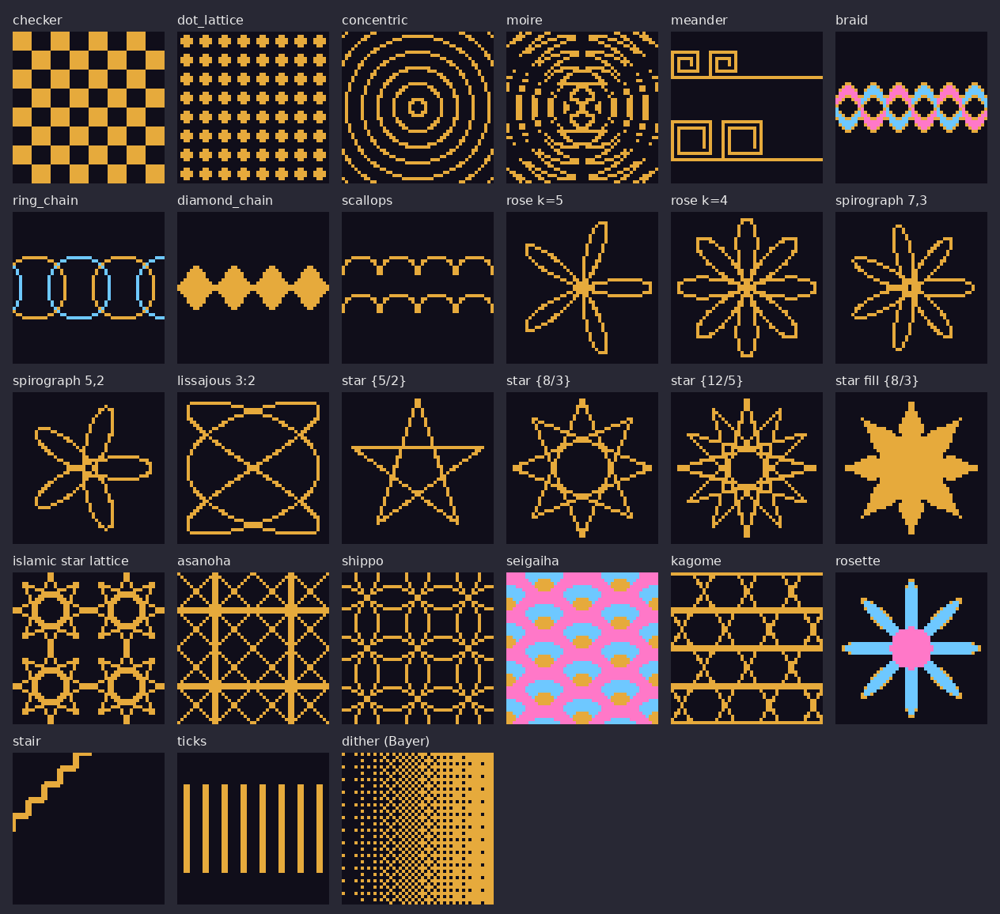

# Geometric patterns for pixel art

Formula-driven pattern toolkit: `tools/item-art/scripts/geometry/` (numpy + Pillow). Used by the rarity tooltip
frames (`tools/item-art/scripts/tooltip-frames.py`); usable for GUI tiles, HUD borders and item art alike.
Swatches: `docs/assets/geometric-patterns-catalog.png` (regenerate with
`python3 tools/item-art/scripts/geometric-catalog.py`).

## Method

1. Evaluate on pixel centres: `X, Y = grid(w, h)` (`x + 0.5`, `y + 0.5`). Never anti-alias; threshold a distance
   field (`stroke(d, width)`) so every pixel is on or off.
2. Build a pattern as a mask from a formula, then paint masks in painter's order onto a `Canvas` of integer
   shade levels (0 clear, dark, base, light, white, deep, glow). 2-3 shade levels give relief:
   `bevel(mask)` returns the NW-lit rim and SE-shaded rim of a filled shape; `outline(mask)` the halo ring.
3. Exploit symmetry instead of drawing twice: `rot_fold`/`dihedral_fold` (C_n / D_n), `p4m_fold` (square
   wallpaper group), `sym_diag` (diagonal mirror), flips for the four corners.
4. 1 px lines must sit on pixel centres (coordinates + 0.5), otherwise a line covers two pixels.
5. Periodic strips: evaluate 3 periods wide and crop the middle one; the period must divide the tile the engine
   repeats (tooltip sprite: 12 px).
6. Tone: `dither(field, X, Y)` ordered (Bayer 4x4) dither turns a 0..1 field into a pixel mask.

## Catalogue

| function | formula / construction | parameters |
|---|---|---|
| `checker` | `(floor(x/c) + floor(y/c))` even | `cell` |
| `dot_lattice` | disc at every lattice point | `period, r, offset` |
| `concentric` | `abs(mod(r, pitch) - pitch/2) <= w/2`, `r = dist(centre)` | `cx, cy, pitch, width, phase` |
| `moire` | XOR of two `concentric` families with different centres | two centres, `pitch` |
| `meander` | Greek key: baseline + square spiral hook, 2 px pitch, repeats every `period` | `period, top` (band height = `period - 4`) |
| `braid` | Celtic two-strand: `y = cy +/- A sin(2 pi x / T)`, over/under flips at each crossing (every T/2) | `period, cy, amp, width` |
| `ring_chain` | circles of radius r > period/2 centred every period, interlaced over/under | `period, cy, r` |
| `diamond_chain` | rhombi `abs(dx)/a + abs(dy)/b <= 1` every period | `period, cy, half_w, half_h` |
| `scallops` | circular arcs radius r every period | `period, top, r` |
| `rose` | `r = R cos(k theta)` (k petals odd, 2k even) | `k, R` |
| `spirograph` | hypotrochoid `x = (R-r) cos t + d cos((R-r)/r t)`, `y = (R-r) sin t - d sin((R-r)/r t)`, closes after `r/gcd(R,r)` turns, scaled to `fit` px | `R, r, d, fit` |
| `lissajous` | `x = ax sin(a t + delta)`, `y = ay sin(b t)` | `a, b, delta` |
| `star_outline` / `star_fill` | star polygon {n/k}: every k-th vertex of a regular n-gon; fill = even-odd + inner n-gon | `n, k, r` |
| `islamic_star_lattice` | an {8/k} star in every square cell (star-and-cross tiling) | `period, k` |
| `asanoha` | hemp leaf: cell diagonals, midlines and midpoint diamond (p4m fold) | `period` |
| `shippo` | circles of radius `period/sqrt2` on a square lattice (seven treasures) | `period` |
| `seigaiha` / `seigaiha_levels` | discs radius R on a half-offset grid (row pitch R/2, column pitch 2R), nested rings, lower rows on top | `R, rings` |
| `kagome` | three line families at 0/60/120 deg, spacing p, offsets break the triple crossings | `period, offset` |
| `rosette_levels` | petal envelope `R (0.5 + 0.5 cos(n a))` in polar coordinates | `petals, R` |
| `stair` / `ticks` | stepped corner, periodic dashes | |

Helpers: `seg_dist`, `polyline_dist`, `periodic_polyline_dist`, `circle_dist`, `polygon_inside`, `ngon`,
`star_polygon`, `shift`, `Canvas`.

## Tooltip frame motifs (UI-14)

| rarity | edge strip (12 px period) | corner (12x12) |
|---|---|---|
| common | single line | chamfer |
| uncommon | double line + ticks | stair step |
| rare | diamond chain between rails | checker block |
| epic | Greek key meander | octagram {8/3} |
| legendary | Celtic braid + glow + sparks | ring medallion with octagram + 8 studs |

Minecraft tiles (not stretches) nine_slice edges when `stretch_inner` is absent/false; see
`content/textures/gui/sprites/tooltip/README.md`.
