# Beat sheet — bastion-greatsword-s1 (月輪の薙ぎ), r3, founder gate 1

```
Case: bastion-greatsword-s1   Reference: Svaaq9F7Ty8 t=11.633..14.233   Mirrored: no (the caster faces screen-right = the enemy in the reference wide shots, same as skill-compare)
Swings: 2 (cut 1 starts at tick 4, cut 2 starts at tick 29; body reversal at tick 27-29 between them)
Notes: see "Notes" below the table (depth cues, conversions, unknowns, how the numbers were measured)
Diagrams: ASCII top-down / side / front per swing below; PNG stick figures per beat in the round notes (beat-00..12.png)
```

All positions are caster-local `(forward, right, up)` in blocks. Origin = the caster's feet at cast time. Blade length is about 2.0.
Body yaw is the torso yaw from caster-forward. `+` = toward the caster's left.
Camera CW/CCW and top CW/CCW follow `docs/contributing/vfx-team/beat-sheet.md` §Vocabulary.

| beat | tick range | swing # | blade-tip start -> end (3D) | rotation direction | rotation angle | edge facing | reverses previous beat? | body facing and twist | foot positions | hit tick | VFX & particles |
|---|---|---|---|---|---|---|---|---|---|---|---|
| B0 coil hold | 0-3 | - | `(-1.78, 1.17, 0.03)` held. The tip lies on the floor behind the caster's right heel; the blade runs from the grip at the right hip down and back. | camera: none (n/a: blade held still); top: none (held) | 0° | flat. The broad face points up and toward the camera (flat face toward camera). | no (first beat) | yaw -35 (chest turned toward the camera side), hips take 45% of the twist, lean forward 22°, crouched (hips 0.2 low) | L `(0.45, -0.14)` planted, R `(-0.42, 0.36)` planted. Wide stance. | - | sheath: vanilla dust/crit scatter around the blade root -> tip every tick (held-pose sheath) |
| B1 wind-back (anticipation) | 3-4 | - | `(-1.78, 1.17, 0.03) -> (-2.26, 0.71, 0.90)`. The tip lifts off the floor to waist height, further behind the right shoulder. | camera: CW (tip goes back and up: lower-left -> left on screen); top: CW (back-right -> back, against the coming cut) | 15° about the body, +0.87 up | edge-leading (velocity 21° off the face plane). Face mostly up; the camera sees the broad face, foreshortened. | no (the first motion after the hold; cut 1 reverses it) | yaw -35 -> -45 (winds further to the right), lean 28°, hips 0.24 low | planted, unchanged | - | ring 1 not yet visible. Sheath continues. |
| B2 cut 1 travel | 4-6 | 1 | `(-2.26, 0.71, 0.90) -> (0.16, 2.13, 1.11) -> (2.38, 0.18, 1.68)`. A rising arc from behind the right shoulder, out past the caster's right side (the camera side), to the top front over the enemy. | camera: CCW (this is the near, lower half of the cut-1 loop; it runs back -> forward low on screen and returns high in B3-B4, so the whole loop reads CCW: bottom left->right, top right->left); top: CCW (back -> right -> forward) | 158° (77 + 81 per tick), the tip rises 0.8 | edge-leading (14-22°). The broad face points up; from the slightly raised compare camera the face is seen from above. | yes: top direction flips from CW (B1) to CCW, and the body turn flips from winding right to turning left | yaw -45 -> +5 -> +50. The shoulders lead, and the hips take 45% of the turn. Lean 22-28°. | planted, unchanged (pivot on both feet) | - | ring 1 (high, tilted ring, rises from 0.9 behind to 1.7 in front) grows from behind the right shoulder; its head follows the tip CCW from above. A cut trail of dust/sweep particles follows the tip's arc each tick, behind the tip. |
| B3 cut 1 contact | 6-7 | 1 | `(2.38, 0.18, 1.68) -> (0.20, -2.23, 1.22)`. Across the front, from over the enemy to the caster's far left side, descending a little. | camera: CCW (the far, upper half of the loop: forward -> back high on screen, right -> left); top: CCW (forward -> left) | 89° | edge-leading (14°). The face points up. | no | yaw +50 -> +95 (the back turns toward the camera) | planted, unchanged | t=7 (hit-stop t7-9: pose and VFX freeze) | ring 1 head reaches the far side. Impact burst (crit/sweep scatter) at the blade point nearest the target on t7. Trail behind the tip. |
| B4 follow-through | 7-12 | 1 | `(0.20, -2.23, 1.22) -> (-1.83, -1.01, 1.62)`. Continues from the left around to behind the left shoulder, rising and slowing. | camera: CCW (forward -> up -> back on screen: right -> upper left); top: CCW (left -> back) | 66° (41 -> 18 -> 7 per tick after the hit-stop) | edge-leading (14-20°) -> flat when it stops at t12 | no | yaw +95 -> +115 (back to the camera, overturned past the enemy line) | planted, unchanged | - | ring 1 closes behind the tip by t14 and fades out by t19. Ring-whirl sound at t8. Trail behind the tip on the moving ticks. |
| B5 over-shoulder hold | 12-16 | 1 | `(-1.83, -1.01, 1.62) -> (-1.91, -0.93, 1.54)`. Nearly still, high behind the left shoulder. | camera: none (n/a: 0.1-block drift, reads as held); top: CCW drift (3°) | 3° | flat. The broad face is up/toward the camera. | no | yaw +115 -> +120 | planted, unchanged | - | sheath on the held blade. Ring 1 fading. |
| B6 settle to rest | 16-19 | 1 | `(-1.91, -0.93, 1.54) -> (-2.03, -0.73, 0.99) -> (-2.07, -0.38, 0.03)`. The blade falls from the shoulder to the floor behind the caster, while the body keeps turning. | camera: CCW (back-high -> back-low: on screen left side moving down; about the hips this is up->back->down = CCW); top: CCW (16°, back-left -> back) | 16° about the body, -1.5 drop | mixed: velocity 32° off the face plane (part slice, part slap), broad face toward the camera | no | yaw +120 -> +172 (the caster now faces backward, away from the enemy, screen-left) | planted, unchanged | - | sword-settle sound at t19. Small dust where the tip lands. |
| B7 rest, facing away | 19-27 | - | `(-2.07, -0.38, 0.03)` held: the tip on the floor behind the caster | camera: none (held); top: none (held) | 0° | flat. The broad face points up and toward the camera. | no | yaw +172 held, upright, hips 0.2 low | planted, unchanged | - | sheath every tick. No ring. |
| B8 crouch, body turns back | 27-29 | - | `(-2.07, -0.38, 0.03) -> (-2.00, -0.19, 0.12) -> (-1.98, -0.14, 0.15)`. The tip barely moves and trails on the floor behind while the torso unwinds. | camera: none (n/a: the tip moves 0.1, held); top: blade drifts CCW 6° (trailing), BODY turns CW 60° | blade 6°, body 60° | flat -> edge-leading (43° -> 26° off the face plane) | yes: the body turn reverses (CCW in B2-B6 -> CW now, 60°) | yaw +172 -> +112 (CW). The hips drop 0.30-0.32 (deep crouch). | t28-30: both feet slide 0.7 forward with the dash (`dash_strike` translates the caster; no step is animated). Stance shape unchanged. | - | ring 2 is spawned at t28 (low, flat), not yet drawn ahead of the tip. |
| B9 cut 2 low sweep + thrust | 29-31 | 2 | `(-1.98, -0.14, 0.15) -> (-0.05, -2.22, 0.27) -> (2.44, -0.09, 0.60)`. A low sweep from behind, around the caster's far left side at shin height, ending in a thrust at the enemy at waist height. | camera: CW (the far side reads higher on the raised camera: top of the loop runs left -> right back -> forward; the return in B11 runs right -> left along the floor, so the loop reads CW); top: CW (back -> left -> forward) | 174° (85 + 89 per tick) | edge-leading (3-10°). The broad face is flat up; the camera sees it edge-on to slightly from above. | yes: the rotation reverses (cut 1 top CCW -> cut 2 top CW); the body continues the CW reversal started in B8 | yaw +112 -> +60 -> 0 (square to the enemy at the thrust). Crouched, hips 0.24-0.32 low. | sliding forward with the dash until t30 (0.7 total), then planted at the new spot `(+0.7)` | t=31 (hit-stop t31-33) | ring 2 (low, shin-knee height, horizontal) head follows the tip CW from above, behind -> far side -> front. Cut trail along the arc; impact burst at t31 at the blade point nearest the target. |
| B10 thrust hold | 31-38 | 2 | `(2.44, -0.09, 0.60) -> (2.42, 0.40, 0.56)`. The blade is held pointed at the enemy, drifting a little to the caster's right. | camera: none (n/a: the drift is toward the camera = depth); top: CW drift (11°, forward -> slightly right) | 11° | edge-leading during the drift (16°). The face is flat up; the camera sees it edge-on. | no | yaw 0 -> -5. Crouched, rising slightly. | planted at +0.7 | - (contact was t31) | ring 2 closes behind the tip by t34-35 and fades out by t41. Sheath on the held blade. |
| B11 drop and follow back to the coil | 38-41 | 2 | `(2.42, 0.40, 0.56) -> (0.34, 2.14, 0.03) -> (-1.34, 1.69, 0.03) -> (-1.78, 1.17, 0.03)`. The tip drops to the floor and sweeps round the caster's right side (the camera side) to behind the right heel. | camera: CW (forward-mid -> down -> back along the floor: on screen right -> lower -> left, the bottom of the cut-2 loop moving right -> left); top: CW (forward -> right -> back) | 137° (72 + 47 + 18 per tick) | edge-leading (6-17°) -> flat at t41. Broad face up / toward the camera. | no | yaw -5 -> -35 (back in the coil twist) | planted at +0.7 (coil stance shape) | - | trail behind the tip along the floor arc. Ring 2 fading. |
| B12 coil hold, hand-back | 41-52 | - | `(-1.78, 1.17, 0.03)` held. At t52 the vanilla held-item pose returns. | camera: none (held); top: none (held) | 0° | flat. The broad face is up/toward the camera. | no | yaw -35, crouched | planted at +0.7 | - | sheath every tick until the hand-back |

## Totals and checks

**Swing 1 (cut 1)**
- The tip turns 332° top CCW from t4 to t19 (158 + 89 + 66 + 3 + 16), after a 15° CW wind-back at t3-4.
- The body turns from yaw -45 to +172, which is +217° CCW.

**Swing 2 (cut 2)**
- The tip turns 322° top CW from t29 to t41 (174 + 11 + 137).
- The body turns from yaw +172 to -35, which is -207° CW. The reversal starts at t27, before the blade moves.

**Interpolation.** No single tick turns more than 89°, and the client slerps each step in the authored direction.

**Reversals**
- B1 -> B2: the top direction changes CW -> CCW (wind-back into cut 1).
- B8: the body turns back CW by 60° while the blade trails.
- B9: the blade rotation changes from cut 1 CCW to cut 2 CW.

## Notes

**How the numbers were measured.** Every number in the table comes from the shipped keys (`content/animations/bastion-s1-body.yaml` + `content/vfx/bastion-s1-rig.yaml`, rig forward kinematics). The rotation directions match the founder's reading of the reference:
- cut 1 is camera CCW;
- cut 2 reverses the body and is camera CW.

**Evidence in the reference**
- t0-5: the caster is three-quarters to the camera.
- t7: the back is to the camera.
- t19-27: the caster faces away from the enemy.
- t27-28: the caster is still facing away from the enemy (yaw +172 to +142); the back turns toward the camera only around t29.
- t31: square to the enemy.
- t39-40: the blade crosses the near side, right -> left on screen.

**Depth cues used.** Which shoulder leads, whether the blade is in front of or behind the torso, and whether the caster shows their back or their chest to the camera.

**Camera direction of the horizontal cuts.** Both cuts are near-horizontal rings, so the side camera sees each one as a thin ellipse. The direction comes from which half of the loop is higher on screen:
- the compare camera is raised, so the far half reads higher than the near half;
- cut 1's far half is also physically higher: 1.2-1.7 versus 0.9-1.1 on the near half.

The top column is the authoritative direction.

**Conventions added after the reverse check**
- Slice versus slap: *edge-leading* means the tip velocity is within about 20° of the broad-face plane (it slices). Above about 30° the blade starts to slap (B6 is mixed at 32°, B8 starts at 43°).
- Tip coordinates are always caster-local at that tick, in the caster's *current* frame. After the dash (t28-30) the caster stands 0.7 forward of the cast-time origin, so B9-B12 tips are relative to the moved caster. This is why B11 and B12 end on the same coil coordinates as B0.
- Swing 1 is t4-t19, and its diagram starts at t3 to show the wind-back. Swing 2 is t29-t41, and its diagram starts at t27 to show the body reversal.
- Hit-stop (t7-9, t31-33) freezes the pose and the VFX but not the sound. Per-tick angles in B4 describe the moving ticks only (t10-12).
- Feet are planted while the torso turns, and the hips take 45% of the yaw. Both legs keep their stance, and the body twists above them.

**Previous keys (r27) did not match.**
- Every key was a step cut, so no travel was drawn.
- Cut 1 flipped 185° at t5-6, so its direction was undefined.
- Cut 2 turned CCW at t29-30, the wrong way.

**Known gaps against the reference (flagged for gate 1)**
- The reference holds the coil still through about t5. The keys lift the blade at t4 (B1) so that cut 1 has an anticipation, so lint expects FAILs at t4-5.
- Ring 2 is spawned at t28, one tick before the blade moves.
- The dash at t28-30 slides the feet. No step is animated.

## Diagrams (ASCII, caster-local)

Path `.` = the tip, sampled every 0.1 tick. Letters mark the tip in order of travel.

```
Swing 1 (cut 1, t3-t19)   path '.' = tip every 0.1 tick, letters in order of travel: a=t3  b=t4  c=t5  d=t6  e=t7  f=t12  g=t19
TOP (forward = up, caster's right = right; C caster, E enemy)
|                    E                    |
|                     d                   |
|                 . .   . .               |
|             . .           . .           |
|         . .                  .          |
|       .                        ..       |
|     .                             .     |
|    .                               .    |
|   e                C               c    |
|   .                                .    |
|   ..                              ..    |
|    ..                            .      |
|      ..                         .       |
|       .....                   ..        |
|           .f... g         ..a           |
|               ...       b..             |
|                                         |
SIDE = skill-compare camera (forward = right, up = up; C caster feet)
|                                         |
|     .f.                       ......d   |
|     . ........... .   . ......          |
|    ... . . . . . . ce .                 |
|   b..                                   |
|   ..                                    |
|    ..                                   |
|    g a            C                     |
FRONT = seen from the enemy (caster's right = screen left)
|                                         |
|           . . . . d . . . .f...         |
|     . .. .                .   .......   |
|    c.....                .          e   |
|           . ..b         ..              |
|             .          ..               |
|            .          ..                |
|           a        C  g                 |

Swing 2 (cut 2, t27-t41)   path '.' = tip every 0.1 tick, letters in order of travel: a=t27  b=t29  c=t30  d=t31  e=t38  f=t39  g=t40  h=t41
TOP (forward = up, caster's right = right; C caster, E enemy)
|                    E                    |
|                 . d...e .               |
|            .  .           ..            |
|          .                   .          |
|        .                      . .       |
|       .                          .      |
|    ..                             ..    |
|   .                                f    |
|   c                C               .    |
|    .                               .    |
|    .                              ..    |
|      ..                          ..     |
|         .                       g.      |
|          . .                ....        |
|               . a.b         h           |
|                                         |
|                                         |
SIDE = skill-compare camera (forward = right, up = up; C caster feet)
|                                         |
|                                         |
|                                         |
|                                         |
|                                         |
|                                   ..e   |
|     b         . . c .  . . .. .....     |
|    a.h..g...... .... f . . .            |
FRONT = seen from the enemy (caster's right = screen left)
|                                         |
|                                         |
|                                         |
|                                         |
|                                         |
|               . e...d . .               |
|       . .. ..       b      . . .. ..c   |
|    f..g...h        C..a .  . .. ..      |
```

## Reference check: where the sheet's reading of Limbus is certain and where it is not

Under each stick diagram below, the red-labelled strip shows the reference video frames of that beat (skill ticks, 20 TPS from `start_s` 11.633), so you can compare our numbers with Limbus directly.

**Certain (read from successive frames)**
- t0-5: the coil is still. The blade lies on the floor behind the caster, and the caster is three-quarters to the camera.
- t6-8: cut 1 appears as a gold ring that sweeps CCW. The first big frame is t7 (close-up with sparks), the hit.
- t9-17: the follow-through. The ring closes by about t16 and the blade ends behind.
- t19-27: the blade rests on the floor ahead of the caster's left (screen-left), and the caster faces away.
- t30-33: the close-ups of cut 2.
- t33-38: the thrust with a ring around it, held.
- t39-41: the blade comes back to the coil.

**AMBIGUOUS (flagged for the founder at gate 1)**

| beat | what is unclear in the reference | what we assumed |
|---|---|---|
| B1-B2 (t4-5) | The reference is still. It shows no lift or wind-back, so our wind-back at t3-4 and the early travel at t4-5 are a deliberate deviation. | The wind-back gives cut 1 an anticipation. Lint is expected to FAIL at t4-5. |
| B3 and B4 (cut 1's far half) | The blade leaves the camera plane toward the far side, so the 2D picture does not show how high it is or how deep. | Height 1.2-1.6 from the raised-camera overlap, and a continuous CCW arc from the top view. |
| B6 settle (t16-19) | The smear is gone and the blade is seen only from the side, so the path down to the floor is unclear. | A straight drop to the floor behind, while the body keeps turning CCW. |
| B8 turn (t27-29) | The cape hides the back, and the blade barely moves. The body reversal is seen only in the shoulders. | A 60 degrees CW body turn at t27-29, with the dash starting at t28. |
| B9 (t29-31) | The close-up frames crop the blade, so the low sweep's depth is a guess. | A shin-height sweep around the far side, ending in the thrust. |
| B11 (t38-40) | The near arc is mostly depth. | The sweep passes the near (right) side along the floor. |

## Stick diagrams per beat (top / side = compare camera / front = from the enemy)

These are drawn from the shipped keys.
- The faint figure is the start pose and the dark figure is the end pose.
- The red line is the blade-tip path; its arrow shows the direction of travel.
- The green arrow shows which way the chest faces.
- In the top panel, the enemy is at the top and the caster's right is on the right.
- B12 is the same pose as B0.

**B0 coil hold**

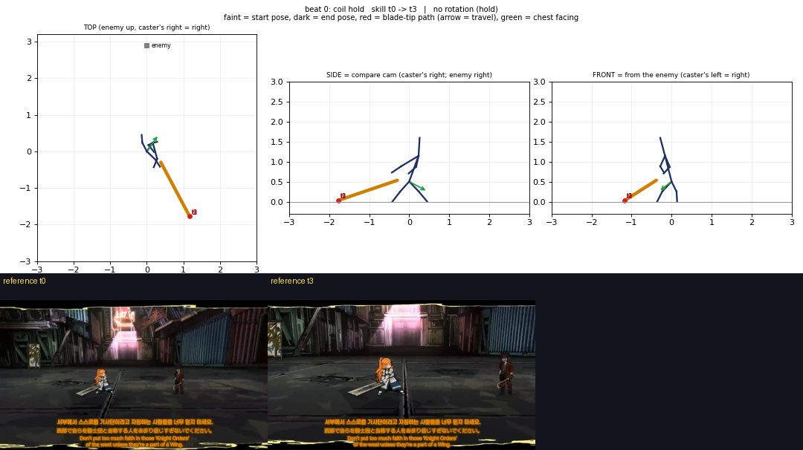

**B1 wind-back**

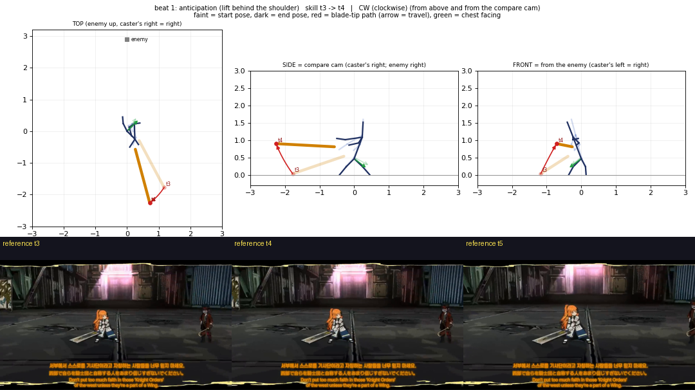

**B2 cut 1 travel**

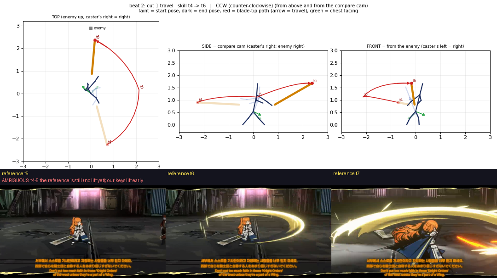

**B3 cut 1 contact**

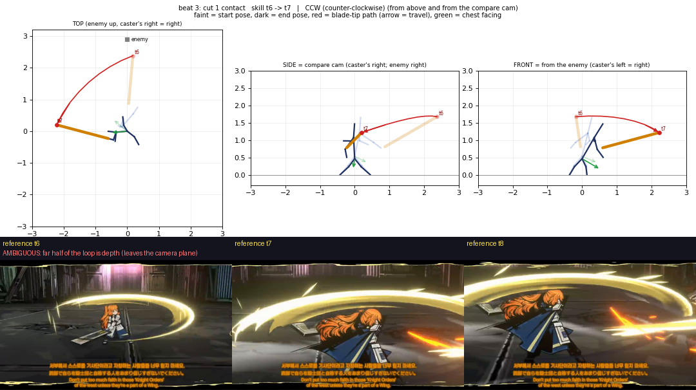

**B4 follow-through**

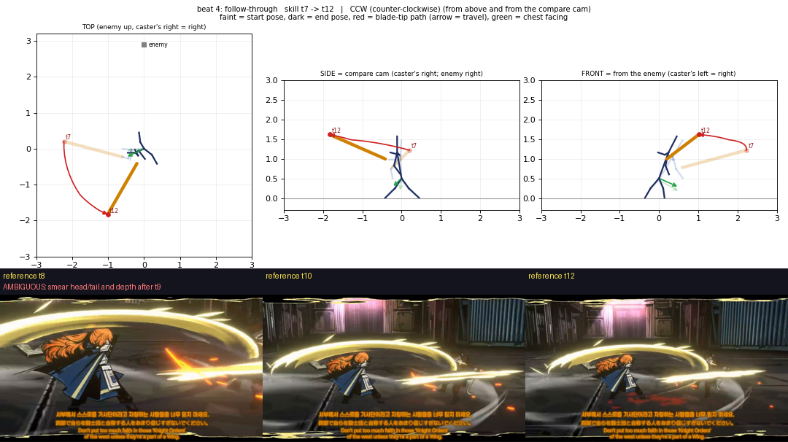

**B5 over-shoulder hold**

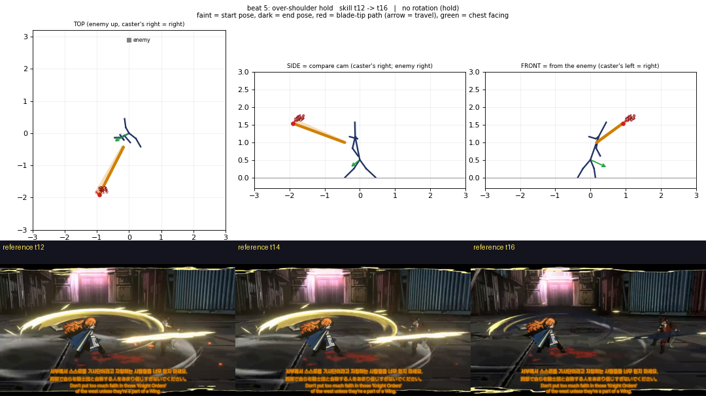

**B6 settle to rest**

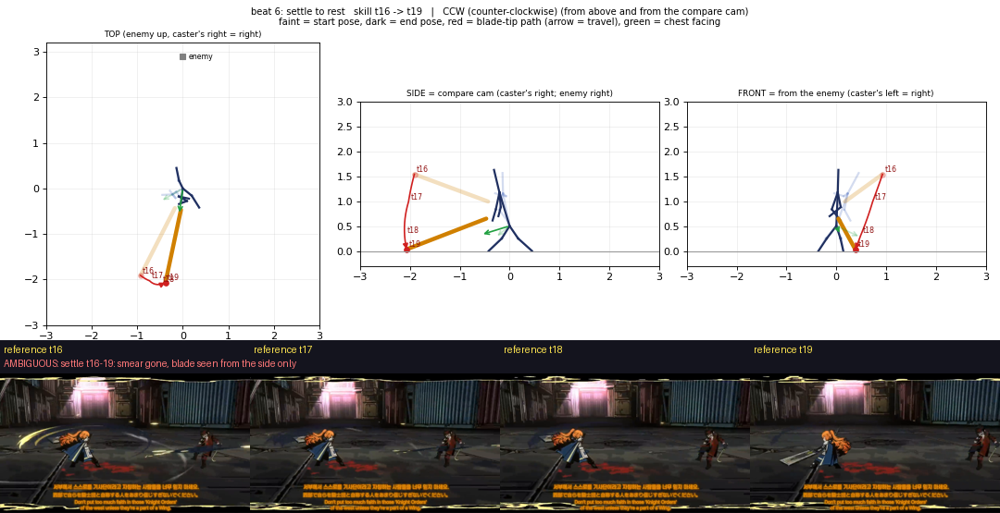

**B7 rest facing away**

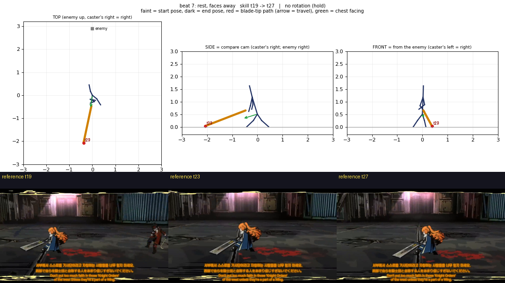

**B8 body turns back**

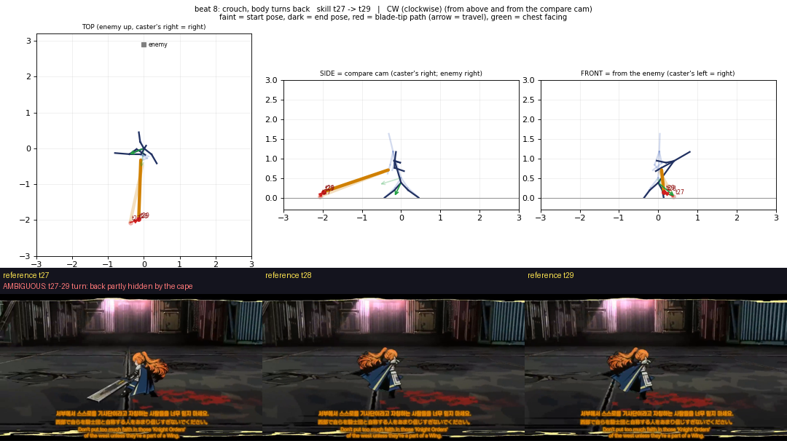

**B9 cut 2**

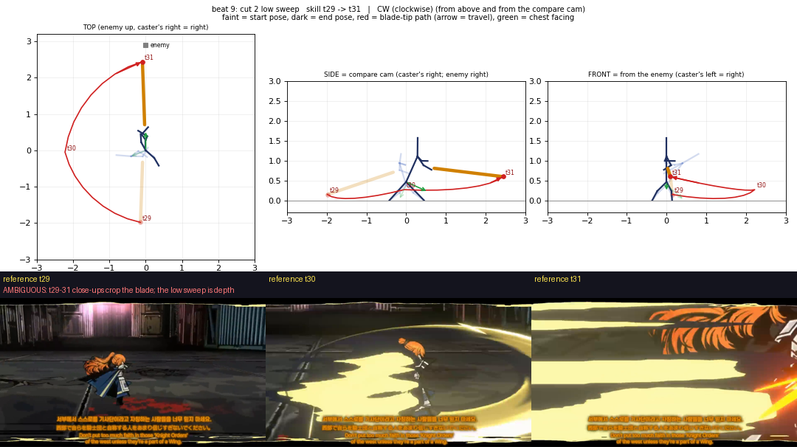

**B10 thrust hold**

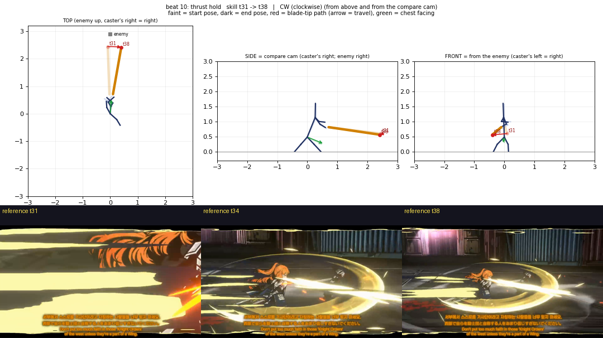

**B11 back to coil**

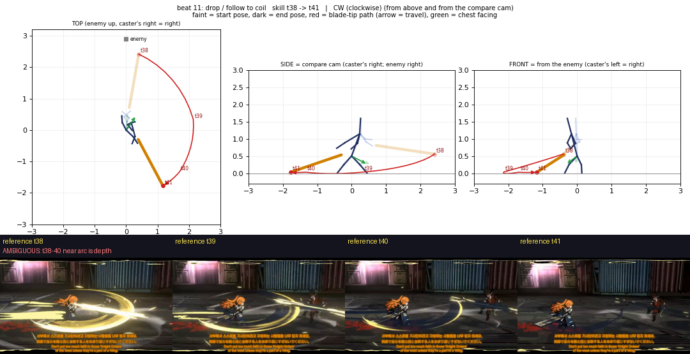
