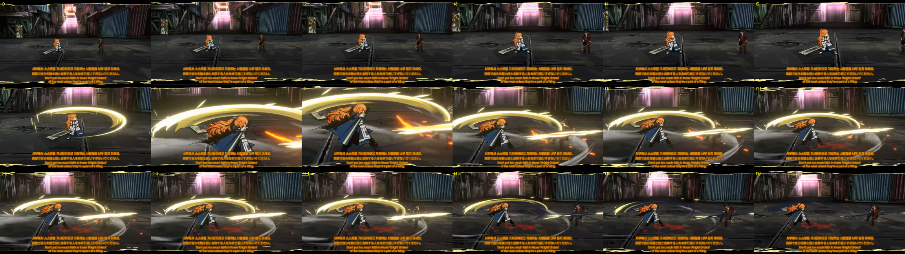
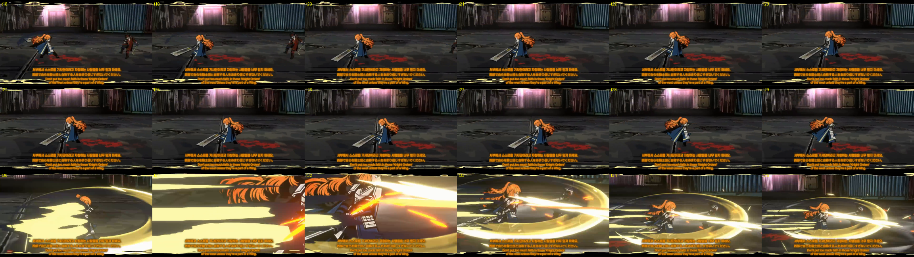
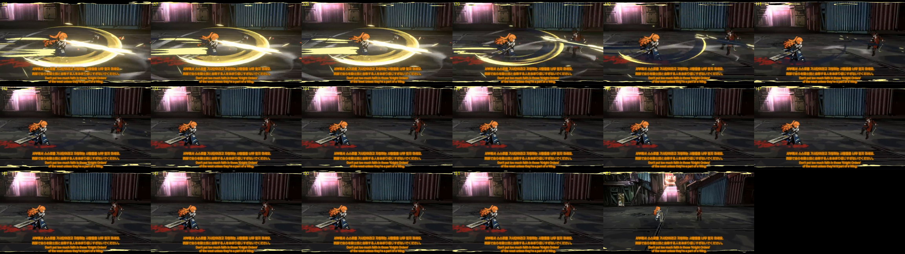

# S1 月輪の薙ぎ ビートシート (リファレンスのみから作成)

リファレンス動画 11.633-14.233 s (イシュメール, 20 tick/s, t0 = 動画 11.633 s) のコマ送りだけから書き直した。ビルド(キー・YAML)は参照していない。
各セルの末尾の印: **[観測]** = コマ/計測から直接読めた、**[推定]** = 観測から導いた、**[不明]** = 読めない(カメラが動く、マントで隠れる等)。

読み方の約束:
- 「カメラから」= リファレンスのカメラ視点(やや上から、イシュメールの右側から見る)。「上から」= 真上視点。
- 向きは時計回り(右回り, CW)/反時計回り(左回り, CCW)。
- 移動 = 足元の地面上の移動(ブロック換算、体長 約 1.8 ブロック基準)。カメラが t6-9 と t29-33 でズーム/寄りを入れるため、画面上の位置では移動量を直接測れない区間がある。

## ビート表

| ビート | tick | 斬撃 | 回転方向 (カメラ / 上から) | 刃の向き(刃先が先行か平か) | 反転 | 接触 tick | 移動(距離・向き) | 音イベント |
|---|---|---|---|---|---|---|---|---|
| B0 溜め保持 | 0-3 | - | カメラ: なし [観測] / 上: なし [観測] | 平(広い面が上〜カメラ向き)、刃は右足の後ろ低く [観測] | - (最初) | - | 足は固定。移動 0 [観測] | 足のこすれ音 t0 [観測] |
| B1 振りかぶり | 3-4 | - | カメラ: 刃が後ろ上へ上がる = 左回り気味 [推定] / 上: 右後ろへ引く [推定] | 刃先が先行 [推定] | なし [推定] | - | 移動 0 [推定] (画面で足が動かない) | 剣を持ち上げる音 t2 [観測] |
| B2 斬撃1 前半 | 4-7 | 1 | カメラ: 左回り(CCW)。背中側から右サイド、前へ上がる [観測] / 上: 左回り(CCW) 後ろ→右→前 [観測] | 刃先が先行 [推定]。スイング面はほぼ水平、傾き約 3° [観測] | 振りかぶり(B1)の逆回転 [観測] | - | 前進 約 1 ブロック、敵方向(カメラの右)、t4-6 [推定] (t0 の敵との間隔 約 3.5 → t15 で約 1.8。カメラ寄りで直接は測れず) | 重い風切り t4 [観測] |
| B3 接触 | 7-9 | 1 | カメラ: 前で止まり、金のリングが胴の高さに全周 [観測] / 上: 前方で停止 [観測] | 平。リングは腰〜胸の高さ [観測] | なし | **t7** (ヒットストップ約 2 tick) [観測] | 停止(接触で急停止) [推定] | 金属の衝突音 + 低い打撃音 t7 [観測]、鎧のきらめき t8 [観測] |
| B4 余韻 | 9-17 | 1 | カメラ: リングが左へ戻りながら消える(CCW 継続) [観測] / 上: CCW 継続 約 330° 合計 [観測] | 平→刃先が後ろへ流れる [観測] | なし | - | 移動 0 [観測] (敵との間隔だけが縮む = 敵が近づく側 [推定]) | 余韻のきらめき(リング)[観測] |
| B5 戻り・静止 | 17-27 | - | カメラ: なし / 上: なし [観測] | 平、刃は床へ下がり左後ろ [観測] | - | - | 移動 0 [観測] | 剣を収める音 t18 [観測]、剣を持ち上げる音 t22 [観測] |
| B6 反転・しゃがみ | 27-29 | - | カメラ: なし(刃はほぼ動かない)/ 上: 体だけ右回り(CW)約 60° [観測、マントで隠れ肩で判断] | 平 [推定] | **反転** 斬撃1(CCW)→体は CW [観測] | - | 前進開始 t28 [推定] | 風切り(軽め)t26 [観測] |
| B7 斬撃2 + 突き | 29-31 | 2 | カメラ: 右回り(CW)。床すれすれに後ろ→左サイド→前、腰の高さで敵へ [観測] / 上: 右回り(CW) 後ろ→左→前 [観測] | 刃先が先行 [推定]。面は水平、傾き約 2-3° [観測] | 斬撃1(CCW)と逆 = **反転** [観測] | **t31** (ヒットストップ約 2 tick) [観測] | 前進 約 1.2 ブロック、敵方向、t28-30、接触で急停止 [推定] (接触時の寄りの大きさから。実測不可) | 風切り t26、衝突音 + 打撃音 + 地面を打つ音 t31 [観測] |
| B8 突き保持 | 31-38 | 2 | カメラ: なし(刃は敵へ向けたまま、わずかに右へ流れる)/ 上: CW 約 11° [観測] | 刃先が敵向き、面は水平 [観測] | なし | - | 移動 0 [観測] (新しい位置で固定) | 鎧のきらめき + リングの渦 t32 [観測] |
| B9 戻し | 38-41 | 2 | カメラ: 右回り(CW)。右サイドから後ろへ、床へ落ちる [観測] / 上: CW 約 137° [観測] | 刃先が先行 → 最後に平 [推定] | なし | - | 移動 0 [観測] | 無音 [不明] |
| B10 静止 | 41-52 | - | なし [観測] | 平 [観測] | - | - | 移動 0 [観測] | 剣を収める音 t40 [観測] |

## 合計と確認

- 斬撃は **2 回**。斬撃1 = 左回り(CCW)、斬撃2 = 右回り(CW)。上から・カメラからとも同じ向きの読み(カメラは水平に近い角度なので、リングの手前側の動きで向きが決まる) [観測]。
- 反転は 2 か所: B1→B2 と B6→B7 [観測]。
- 接触 tick は 7 と 31 [観測]。
- 前進の合計は約 2 ブロック(斬撃1 で約 1、斬撃2 で約 1.2)、すべて [推定]。敵との間隔の変化(約 3.5 → 約 1.8)から導いた値で、カメラのズームのため足元の絶対距離は [不明]。前進は接触で急停止する、というのは [推定]。
- マントが背中を隠すため B6 の体の回転は肩の動きだけで判断している [推定]。

## ビルドとの差分 (シートはビルドに合わせて書き換えていない)

1. **移動量**: シートの前進は斬撃1 約 1.0 / 斬撃2 約 1.2 (どちらも [推定])。ビルドは斬撃1 = 1.0 (t4-6)、斬撃2 = 1.2 (t28-30)。実機の距離は敵が 1.7 ブロック手前で止まる上限を受けるので、敵が近いと短くなる。
2. **音量の出所**: シートの音イベント(位置・種類)は deliver/sound-cues.yaml と一致。音量はサウンド担当の較正値で、このシートでは判断していない。
3. **刃の向き(エッジ)**: シートは大半が [推定]。ビルドは「刃先先行」で設計。実機との向きの差は未検証。
4. **B1 振りかぶり**: シートは [推定] のみ。リファレンスでは t3-5 の画面がほぼ静止して見え、ビルドの振りかぶり(t3-4)はリファレンスにない演出の可能性がある。
5. **B9 音**: シートは [不明]。ビルドは t40 の剣を収める音のみ。
