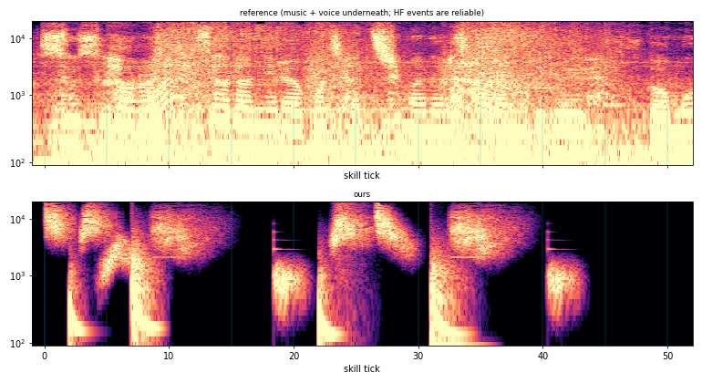
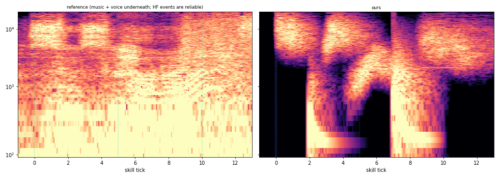
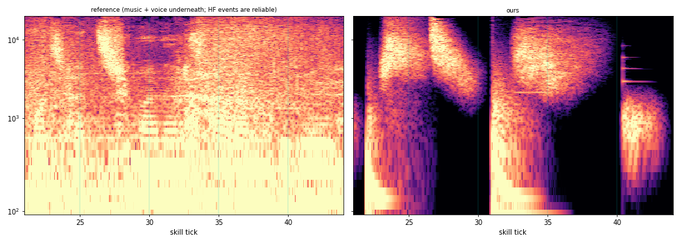
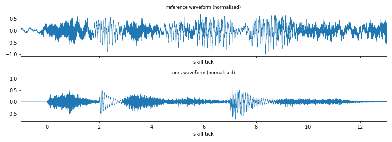
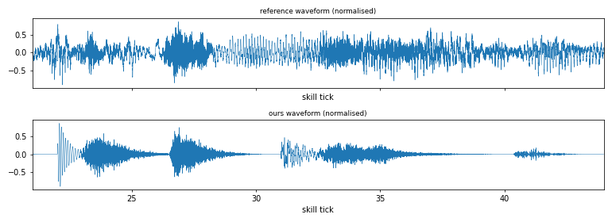

# S1 sound r2: reference-matched SFX

All ten cues were re-synthesised from numbers measured on the reference (analysis only, nothing derived from the game audio is in the repo). Images: spec-full / spec-hit1 / spec-hit2 (reference above, ours below) and wave-hit1 / wave-hit2.

## Reading the reference
- The clip has continuous music and voice under the SFX. Below ~2 kHz the reference numbers are unreliable; the bright events (4.5-16 kHz) and the excess spectrum (window minus the pre-onset median) are reliable.
- Per hit: a dull 150-500 Hz body at contact, then a noisy 2-12 kHz shimmer starting about 1.7 ticks after contact. Tails are dry.
- Swing 1 whoosh is mid (centroid ~2.6 kHz, peak ~t5.9); swing 2 is a bright falling sweep (about 12 kHz to 3.3 kHz) peaking about 4 ticks before contact 2. Two bright flicks at t0-1 and t3-4. Settles at t19-20 and t41 are quiet 500 Hz-1 kHz rattles.
- Inter-hit: hit 2 body about -4.6 dB vs hit 1, hit 2 shimmer about +5.3 dB vs hit 1.

## Ours vs reference (full table: feature-table.md)
Onsets are within 1 tick for all 11 events (worst: impact 2 body +0.8, settle 2 -0.4). Centroids are within 20% for all but swing-2 whoosh (+23%) and settle 2 (+48%, quiet event, low confidence). Inter-hit and per-event levels are within 0.2 dB after calibration (by construction: volumes are solved against the reference, relative to the hit-1 body). Decay misses: reference decays on E4/E5/E6/E8 are polluted by the music bed (peak window clipped), so the decay column is only trustworthy for E1-E3, E7, E9-E11 (all within 25% except E7 +31% and E11 -42%).

## Known gaps
- Swing-2 whoosh centroid is high; decay slightly long.
- Settle 2 is brighter and shorter than the reference.
- Impact tails: ours decays about 95 ms to -12 dB, the reference is hidden under music.

## Changes (see 依頼 in the report)
flash-sting removed; whoosh-sweep added; ticks, pitches and volumes in deliver/sound-cues.yaml.

## r2b: timbre pass (after review of the spectrogram)
Review: numbers matched, the picture did not. Fixed: soft band edges plus time-frequency texture instead of brick-wall slabs; impact bodies are sub-80 ms thumps with a pitch drop and wander (no held 150-300 Hz hum); every cue ends in a long cosine fade (no vertical walls); steel (ring, settle tink) is inharmonic partials with different decays, wander and beating. The feature table now has flatness and a timbre metric: log band-energy correlation ref vs ours per event window (4.5-16 kHz and own band). The reference is music-contaminated, so low-band correlations (E4/E8 own band about -0.1) are not meaningful. HF correlation is 0.6-0.8 for E1, E2, E7, E8, E9, E11 and weakest for E6 (0.12) and E10 (0.19). spec-hit1.png / spec-hit2.png are now side by side (reference left, ours right).
