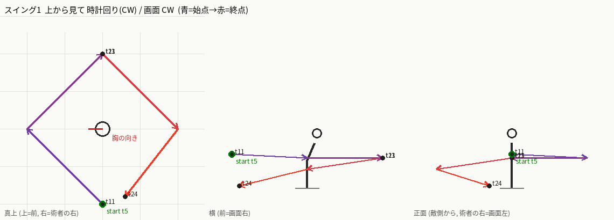
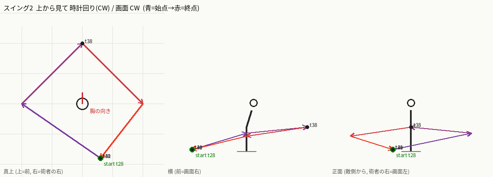
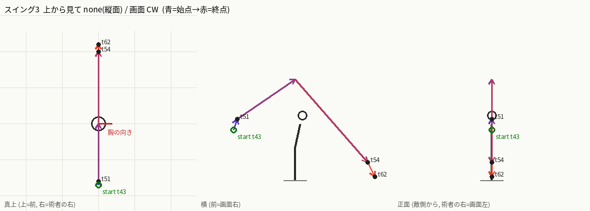

# ビートシート — bastion-greatsword-s2 (審判の突進), r1, 創業者ゲート1

```
Case: bastion-greatsword-s2   Reference: Svaaq9F7Ty8 t=14.633..18.4   Mirrored: no (術者は画面右=敵方向を向く。skill-compare と同じ向き)
Swings: 3 (輪1 は tick 12 (n18) から。B3 は準備の 11 から数える, 輪2 は tick 30 から n45, 縦斬りは tick 51 から n77。接触は t=13 / t=32 / t=53)
Notes: 下の「Notes」(換算・奥行きの手掛かり・不明点)。全セルに [O]/[I]/[U]。
Diagrams: ASCII の真上/横/正面は下記。PNG の棒人形は beat-00..14.png と swing-1..3.png
```

観察のみ(このラウンドはスキルキーも content も書かない)。根拠はすべて参照動画の 30fps フレーム(ローカル番号 `n`、グローバル `f = n + 439`)。tick = floor(n x 2/3 + 0.5)。
位置はすべて術者ローカル `(forward, right, up)` ブロック。原点 = 発動時の術者の足元。大剣の長さは約 2.0。
胴ヨーは前方からの角度。`+` = 術者の左向き。カメラ CW/CCW と top CW/CCW は `docs/contributing/vfx-team/beat-sheet.md` §Vocabulary に従う。
**座標は棒人形用の仮説値(`[I]`)**。参照は画面が頻繁にパン/ズーム/カットされるため、数値そのものは観測値ではない。確かなのは「順序・向き・接触フレーム」。

| beat | tick range | swing # | blade-tip start -> end (3D) | rotation direction | rotation angle | edge facing | reverses previous beat? | body facing and twist | foot positions | hit tick | travel | VFX & particles | sound events |
|---|---|---|---|---|---|---|---|---|---|---|---|---|---|
| B0 構え | 0-3 | - | 大剣は術者の後ろ右下(カメラ側寄り)に低く構えたまま静止。 `(-1.7, 0.6, 0.05)` 保持。n0-4 で刃先は床近く、柄は右腰 [I: 画面左下に刃が寝ている n0-4]。 | camera: none (刃は静止); top: none (静止) [O] | 0° [O] | flat。広い面が上/カメラ側 [I: n0-4 で広い面が見える] | no (最初のビート) [O] | yaw -30 (胸をカメラ側へ), 前傾, 腰 0.2 沈む [I: n0-4 の姿勢] | 両足接地、広い構え。L `(0.4,-0.1)` R `(-0.4,0.3)` [I] | - | none [I] | 剣の周りに薄い粒 [U: n0-4 は小さく判別不能] | t=0.7 低い風切り音のオンセット (14.668s)。性格は [U: 聴いていない。時刻のみ波形 O] |
| B1 沈み込み | 3-5 | - | 刃は後ろ低く(画面左)に留まり、床から持ち上がる様子は見えない。 `(-1.7, 0.6, 0.05)` ほぼ保持 [O: n5-8 でも刃は低く水平、カメラが段階的にズーム]。 | camera: none (刃は動かない); top: none [O: n0-17 刃は低いまま] | 0° [O] | flat [O: n0-17 広い面が見える] | no [O] | 敵向きのまま、腰を落とし前傾、マントが左へなびく [O: n9-17 顔が横向き]。胴の回転は見えない [O] | 接地 [I] | - | none [I] | なし [O: n5-8] | t=2 付近の振幅は小さい (約 0.3)。性格 [U] |
| B2 溜め保持 | 5-12 | - | 刃は後ろ低くのまま保持。 `(-1.7, 0.6, 0.05)` 保持 [O: n9-17]。 | camera: none (保持); top: none (保持) [O] | 0° [O] | flat [O] | no [O] | 敵向きのまま、さらに深く沈み前傾 [O: n17 で顔が横向き]。背を向ける動きはない [O] | 接地 [I] | - | none [I] | 白い点が床の左下に 1 つだけ (n15-17)。剣の根元の粒ではない [O] | n12 (t8) に単発の波形スパイク (0.54)。onset ではない [O]。性格 [U] |
| B3 輪1 発生 | 12-13 | 1 | 背後から術者の左側(カメラと反対側)を通り前へ、ほぼ水平の輪の前半。 `(-2.0, 0.0, 0.9) -> (0.0, -2.0, 0.8) -> (2.0, 0.0, 0.8)` [I: 輪の頭は n18 から前方へ。尾の侵食順から進行方向を決定]。 | camera: none (輪はほぼ水平で動きは奥行き方向。高さ 0.9->0.8 の変化は微小。奥側=左を通る); top: CW (後ろ -> 左 -> 前 -> 右 -> 後ろの順) [I: 画面の輪は頭が前、尾が後ろで侵食。S1 と同様の読み。CW 2回の確認は創業者質問 1] | 約 180° [I] | edge-leading [I: 輪は面内を走る] | no (B2 は保持) [O] | yaw +90 -> 0 [I] (胴が輪の進行と同方向へ回る), 腰 0.35 | 接地、軸足で回る [I] | - | none [I: n18-21 で足位置が変わらない] | 金色〜淡黄色の三日月の弧が前方に現れ、背後側に濃紺の影の尾が付く [O: n18-20]。白は n19 の白い棘状のバーストだけ [O]。前方の筋は **残像で本物の刃ではない** [I]。カメラは n17 と n18 の間でカットし、輪1 の本当の刃の動きは見えない [O] | n18 (t12) の直後に onset 15.33s (t14) [O: 時刻]。性格 [U] |
| B4 輪1 接触・残像 | 13-21 | 1 | 刃は前方で水平に止まる (接触)。残像の板が数 tick 残る。 `(2.0, 0.0, 0.8)` 保持 [I: n20-30 に前方の筋]。 | camera: none (前方で保持); top: none (保持) [O] | 約 0° (ドリフト) [I] | flat -> 保持 [I] | no [O] | yaw 0 [I], 腰 0.35 | 接地 [I] | t=13 [O: n19 に白い棘状のバースト、n20 にオレンジの筋のクローズアップ。接触は ±1 フレーム] | none [I] | n19 白バースト → n20 オレンジの筋(カメラのパンチイン n19-20)。敵のシルエットとオレンジの火花 n21-23 [O]。金色の弧は n30 まで最大サイズで保持 [O]。オレンジ色の火の粉が術者の周りに n21-30 [O]。敵がよろめく n31-36 [O] | t=14 onset 15.33s (振幅小、約 0.5)。接触瞬間は静か [O]。このクリップで最大のうねりは t22-24 (波形 1.0, 15.78s) で、接触ではなく弧の消失と敵のよろめきの間 [O]。性格 [U] |
| B5 輪1 収束 | 21-24 | 1 | 輪が閉じて刃が術者の後ろ右下(カメラ側寄り)へ戻る。 `(2.0, 0.0, 0.8) -> (0.0, 2.0, 0.5) -> (-1.8, 0.6, 0.05)` [I: 弧が縮んで消えるのは n31-34、n35 には剣が後ろ低く戻っている]。 | camera: CW (前 -> 下 -> 後ろ); top: CW (前 -> 右 -> 後ろ) [I: 輪の続き。往復ではなく一周] | 約 180° [I] | edge-leading [I] | no (輪の続き) [I] | yaw 0, 腰 0.2 | 接地 [I] | - | none [I] | 金色の弧が n31-34 で縮んで消える [O]。濃紺の刃状の筋が敵を横切る n33-35 [O: 2 度目のダメージパルスかは [U]] | t=26 onset 15.91s [O: 時刻]。t24-26 の波形は 0.4-0.66 に下がる。性格 [U] |
| B6 低く保持 | 24-28 | - | 刃は後ろ右下(カメラ側寄り)で静止、胴は低いまま。 `(-1.8, 0.6, 0.05)` 保持 [O: n36-42 に構えの形]。 | camera: none (保持); top: none (保持) [O] | 0° [O] | flat [I] | no [O] | しゃがんで前傾、マントが左へなびく [O: n36-41] | 接地 [I] | - | none [I] | なし [O: n36-42] | n36-41 の間は t22-24 のうねりの尾。性格 [U] |
| B7 背向けの捻り | 28-30 | - | 刃は後ろ右下(カメラ側寄り)のまま、胴が背を向けるよう回る。 `(-1.8, 0.6, 0.05)` ほぼ保持 [I: n42-44、画面は n36-41 と同じ広角で少しズームするだけ(カットではない)]。 | camera: none (刃は動かない); top: none (刃は動かず、胴だけ回る) [I] | 刃 0° / 胴 約 120° [I] | flat [I] | **yes?** 胴の回りが B5/B6 と反対 (CCW) か、同じ CW か [U: n42-44 は寄りカット/ズームで決まらない。創業者質問 1] | yaw 0 -> +120 [U: n42-44 でマントと後頭部がカメラ側、顔は見えないので胴が回った可能性はあるが回転方向と量は決まらない] | 接地 [I] | - | none [I] | なし [O] | t=28 の波形は高め (0.7-0.8、16.03s)。性格 [U] |
| B8 輪2 発生・接触 | 30-38 | 2 | 輪1 と同じ水平の輪を再度。背後から左側(カメラと反対側)を通り前へ接触。接触後 t33-38 は前で保持 [I: n50-57]。 `(-1.8, 0.6, 0.05) -> (0.0, -2.0, 0.6) -> (2.0, 0.0, 0.8)` [I: n45-48]。 | camera: none (水平の輪で奥行き方向。上昇 0.05->0.8 は微小); top: CW [I: 輪の尾/頭の侵食順が輪1 と同じ n45-50。胴が逆に回れば CCW になる可能性 [U]] | 約 190° [I] | edge-leading [I] | no (輪1 と同方向) [I] | yaw +120 -> 0 [I] | 接地 [I] | t=32 [O: n46-47 が白バースト/オレンジ筋のクローズアップ。n48 は ±1 フレーム] | none [I] | 金色の三日月が背後側(左)から n45 に立ち上がる [O]。n46 白バースト、n47-48 オレンジの筋のクローズアップ [O]。n49-56 で弧が最大のまま火花とオレンジの火の粉 [O]。敵がよろめく n57-61 [O] | t=32 の音は目立たない。局所ピークは t33 (0.95, 16.26s)、onset 検出なし [O]。性格 [U] |
| B9 輪2 収束 | 38-41 | 2 | 輪2 が閉じ、刃が後ろ右下(カメラ側寄り)へ戻る。 `(2.0, 0.0, 0.8) -> (0.0, 2.0, 0.5) -> (-1.8, 0.6, 0.05)` [I: n57-61]。 | camera: CW; top: CW [I: 輪2 の続き] | 約 180° [I] | edge-leading [I] | no [I] | yaw 0, 腰 0.2 | 接地 [I] | - | none [I] | 金色の弧が縮んで消える n57-61、濃紺の筋が敵を横切る n59-61 [O] | t=40 onset 16.653s は n61 から n62 の剣の持ち上げと一致 [O]。性格 [U] |
| B10 掲げ | 41-42 | - | 刃を後ろ右下(カメラ側寄り)から頭上へ持ち上げる。 `(-1.8, 0.6, 0.05) -> (-1.9, 0.0, 0.7) -> (-1.7, 0.0, 1.4)` [O: 掲げは n61 から n62 の 1 フレームで完了、カットなし]。 | camera: CW? (後ろ -> 上): 上がるだけなので CW 寄り [I]; top: none (縦面の上昇、水平回転なし) [I] | 約 80° [I] | flat -> edge-leading [I] | no [I] | yaw 0 -> -90 [O: n62 で術者はすでにカメラ向き(白いタバードが見える)] | 接地 [I] | - | none [I] | なし [O] | なし (B11 の t=46 onset は B11 側) |
| B11 頭上保持 | 42-51 | - | 頭上に大剣を構えて約 0.5 秒保持、術者はカメラを向く。 `(-1.7, 0.0, 1.4) -> (-1.6, 0.0, 1.7)` [O: n62-76 で約 0.5 秒、頭上に静止]。 | camera: none (保持); top: none (保持) [O] | 0° [O: n62-76 は静止] | flat [I] | no [O] | yaw -90 (カメラ向き) 保持 [I]、直立 | 接地 [I] | - | none [O] | 剣は発光しない [O]。n75-76 に柄の上の白い小物(籠手?)が見えるだけ [O] | t=46 onset 16.909s [O: 時刻]。t48 の波形は 0.33-0.61。性格 [U] |
| B12 縦斬り | 51-54 | 3 | 頭上から正面へ縦に振り下ろす。 `(-1.6, 0.0, 1.7) -> (0.0, 0.0, 2.8) -> (2.0, 0.0, 0.5)` [I: n77-80 の弧は画面で右へ振り下ろす縦面]。 | camera: CW (上 -> 前 -> 下); top: none (縦面、水平回転なし。胴は前を向く) [I: n77-80 の縦の弧] | 約 200° [I] | edge facing は [U: n77-80 は刃がエフェクトに隠れる] | yes: 胴の回りが B10 (CW 90°) と逆 (解く CCW 90°)。刃の回転面も水平から縦へ変わる [I] | yaw -90 -> 0 [I] (カメラ向きから敵向きへ戻る)、腰 0.3 | 接地、踏み込み [I] | t=53 [O: n79 が全画面の金色フラッシュ、n80 がオレンジ筋のクローズアップ。±1 フレーム] | 前へ踏み込みがあるか [U]。あれば約 1-2 ブロック [I: 背景のランドマーク(血痕)と n80-95 の位置関係。パンのため量は [U]] | 縦の金色の弧が背後(左)から頭上を越えて前へ(画面 CW) [O: n77-81]。n77 から敵側に金色の雷バースト [O]。n79 全画面フラッシュ [O]。金色の雷状アークが床に n82-99 [O] | t=54 onset 17.315s、ピーク 0.99 は t56 [O]。性格 [U] |
| B13 低い突き抜け | 54-62 | 3 | 刃は前の床付近まで振り抜く。 `(2.0, 0.0, 0.5) -> (2.2, 0.0, 0.1)` [I: n82-92]。 | camera: CW (下へ); top: none [I] | 約 30° [I] | edge-leading -> 床に刺さる [I] | no [O] | yaw 0, 前傾、腰 0.5 沈む [I] | 踏み込みで前へ滑る [I] | - | 前へ滑るか [U: カメラのパンのため] | 深くひざまずく [O]。金色の雷状アークが床に n82-99 [O]。刃が床に刺さったかは [U] | t=56-64 の持続音 (17.43-17.83s)。性格 [U] |
| B14 床置き保持 | 62-75 | - | 刃を前の前の床すれすれに平らに置いたまま静止、アークが消える。 `(2.2, 0.0, 0.1)` 保持 [O: n96-112 でひざまずく術者の前に灰色の剣が床の高さで敵向き]。突き刺さりは [U]。n113 でカメラが新しい傾いた広角へハードカット [O] | camera: none (保持); top: none (保持) [O] | 0° [O] | flat [I] | no [O] | yaw 0、深く沈む (腰 0.5) [I] | 接地 [I] | - | none [O] | 床の火花は n99-100 まで [O] | 波形は 0.2-0.5 から終端 0.12-0.3 へ減衰、無音ではない [O] |

## Totals and checks

- スイング数: 3 [O]。接触: t=13 / t=32 / t=53 [O: n20 / n48 / n80 の白いフラッシュ]。YAML 側の 3 コインと一致。
- 反転: B7 の胴の回り方向のみ不明 [U]。輪1 と輪2 は同方向 (CW) と読む [I]。縦斬りは面が変わる。
- 所要: 0 -> 75 tick (3.75 秒)。参照 114 フレーム (3.8 秒)。

## Notes

- 換算: 参照は 30fps、tick = floor(n x 2/3 + 0.5)。skill-compare のカメラは術者の右から見るので画面右 = 前、参照は反転なし。
- 参照カメラはパン/ズーム/ハードカット (n17-18、n77、n113) と、接触ごとのパンチイン (n19-20、n46-48、n78-80) があるため、画面位置を移動量として使えない。移動量には背景のランドマーク(血痕)を使ったが、パン中は [U]。
- 方向の読み方: 残像の尾から先に侵食されるので、侵食の最後に残る側が頭。前方の白い筋と長い青黒い板は残像/エフェクトで、実際の刃の位置ではない [I]。
- 座標は発動時の術者原点に固定した枠で書く。踏み込み(B12-B13 の約 1-2 ブロック)は travel 列に別記し、刃先座標には足していない。
- 不明点 [U]: n18-21 の刃の実経路(寄りカット)、n42-44 の胴の向きと回転方向、移動量の大きさ、音の性格(オンセット時刻のみ。聴いていない)、輪1/輪2 が本当に CW 2回か。

## Diagrams (ASCII, 仮説。[I])

```
TOP (真上。上=前, 右=術者の右)         輪1 / 輪2 (水平)               縦斬り (正面から)
        前                                  前                             上
        ^                                   ^  <- 接触                      | 保持(頭上)
        |                              ,---> * -.                           | \
  左 <--+--> 右                        |        |                           |  \ 振り下ろし CW
        |                       左 <--  +   O   +  -> 右                  後 + ---> 前 (床へ)
        v                              `-- ^ ---'  (後ろ→左→前→右→後ろ, CW)
        後                                  後
```

```
SIDE (右から。前=画面右)
輪:    B3 後ろ高さ0.9 ->(下を回って)-> 前 0.8 (接触)  -> 後ろ低 0.05 へ戻る
縦斬り: 頭上(後ろ上 1.7) -> 頂点 2.8 -> 前 0.5 (接触 t=53) -> 床 0.1 (突き立て)
```

```
FRONT (敵側から。術者の右=画面左)
輪は胴を一周する水平の面。縦斬りは中央の縦線。突き立て後、刃は中央の床に刺さる。
```

## 棒人形 (仮説 [I])





## 創業者への質問 (最大 3)

1. 輪1 と輪2 は同じ向き(上から CW)の水平の輪と読んだが、刃の実経路はカットで隠れる。輪2 は逆向き(CCW)か。胴は輪の間で反転するか(B7)。
2. 金色の三日月・濃紺の筋のうち、どこまでを実際の剣の軌跡として再現するか(本物の刃は灰色の剣のみ)。
3. 縦斬り後の踏み込みの距離(カメラのパンで [U])。0 / 1 / 2 ブロックのどれか。
