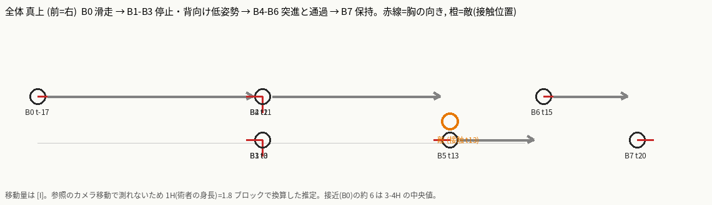
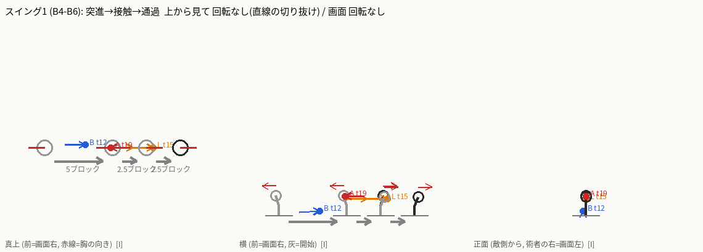

# ビートシート — couture-rapier-s1 (切り合わせ / Retouche), r1, 創業者ゲート1

```
Case: couture-rapier-s1   Reference: GIe7Fna5LD4 t=11.578..14.281 (f347..f428, 接近 B0 を含む)   Mirrored: no (術者は画面左 = 敵(画面右)へ向かう。skill-compare と同じ向き)
Swings: 1 (突進の切り抜けが 1 回。接触 t=13 (f392)。13.67-14.0s の 2 発目に見えるものは花びらの残滓で接触ではない)
Priority: 突進の鋭さ > 当たり判定 = 見た目のリーチ > VFX > 粒 > 姿勢   (PvP 優先)
Notes: 下の「Notes」。全セルに [O]/[I]/[U]。
Diagrams: ASCII は下記、PNG は beat-00..07.png と swing-1.png / overview.png
```

観察のみ(スキル YAML も VFX も書かない。既存 intent / keys は参照していない)。根拠はすべて参照動画 GIe7Fna5LD4 の 29.97fps フレーム(グローバル `f`)。ケースの start_s=12.4458s = f373 = **tick 0**。tick = round((f-373) x 2/3)。接近 B0 (f347-372) は case 範囲の前にあるので **負の tick**。
位置は術者ローカル `(forward, right, up)` ブロック。原点 = そのビート開始時の術者の足元、軸は **発動時の向き**(forward = 敵方向 = 画面右)。ハサミの長さ ≈ 2.2、術者の身長 1H = 1.8 ブロックで換算。胴ヨーは + = 術者の左、180 = 発動方向と逆向き。
camera CW/CCW と top CW/CCW は `docs/contributing/vfx-team/beat-sheet.md` §Vocabulary に従う。座標と移動量は棒人形用の仮説 `[I]`(参照のカメラはカット/パン/ズームするため画面位置は距離にならない)。確かなのは「順序・向き・接触フレーム・開閉」。

| beat | tick range | swing # | blade-tip start -> end (3D) | rotation direction | rotation angle | edge facing | blade open / closed | reverses previous beat? | body facing and twist | foot positions | hit tick | travel | VFX & particles | sound events |
|---|---|---|---|---|---|---|---|---|---|---|---|---|---|---|
| B0 低い滑走(接近) | -17..-1 (f347-372) [I] | - [O] | 閉じたハサミが体の後ろに流れ、刃先は後ろ低く。 `(-1.3, 0.3, 0.35)` 保持 [I: 座標。O: f349 f352 f372 で長い暗い刃が後ろ(画面左)低くへ伸びる] | camera: none (刃は保持); top: none (保持) [O: f349-372 刃の向きが変わらない] | 0° [O] | 刃は進行軸に沿って後ろへ流れるだけ。edge-on(細い暗線)でカメラに見える [O: f352] | closed: 1 本の細長い刃 [I: f349/f352 で 1 本。わずかな開きは区別不能] | no (最初のビート) [O] | yaw 0 (前向き)。胴は前傾 約 60-70°、髪が後ろへ流れる [O: f349-357、顔が画面右]。f358-372 でやや起き上がる [O] | 足は畳まれて床すれすれ、歩幅なし [O: f349-357 足が見えない/畳まれ]。滑走 [I] | - | 前へ滑走 約 3-4H = 5-7 ブロック(中央 6)、後半 f358-372 は減速 [I: カメラが追尾し f347 で画面外 → f372 で画面左 1/3。距離そのものは [U]] | 紫(#8065BA / #B2A0E0)のもやと残像が背後の床にたなびく f348-358 [O]。粒は無し [O] | 音楽床のみ。f362-363 (t=-7) に単発のピーク [O: 時刻]。性格 [U]。vanilla 案 [I]: t=-16 `entity.player.attack.sweep` 小音量 低ピッチ |
| B1 掲げ | 0..1 (f373-375) [I] | - [O] | f372 の滑走ポーズから f373 で**ポーズが 1 フレームで切り替わる**(間のフレーム無し)。閉じたハサミを刃先上に立てて頭の横(画面右)に掲げる(どちらの手かは [U])。 `(0.1, 0.4, 3.0)` 保持 [I: 座標。O: f374 で細長い刃が頭上へ約 1H 突き出る] | camera: none (切替でパスが見えない); top: [U] (切替で経路が見えない) [O: f372→373 に中間フレームなし] | 0° 観測なし。刃は後ろ低く → 真上へ向きが変わる(約 110°)が経路は不明 [O: 切替] | edge-on(細い profile)[O: f374] | closed: 細い 1 本 [O: f374-375] | no (B0 は回転なし。胴の向きだけ変わる) [O] | yaw 0 → -90 (胸をカメラへ向ける)、直立 [I: f373-375 で顔と胸が正面寄り。向きの量は 3/4 見えのため概算] | 両足そろえて直立、接地 [O: f374] | - | none: 滑走が f373 で止まる [O: 背景に対して位置が変わらない] | 紫のもやが消える [O: f373]。粒は無し [O] | f374 (t=1) に音楽の山 [O: 時刻]。性格 [U]。vanilla 案 [I]: t=0 `item.armor.equip_chain` 高め |
| B2 逆手に反転・開く | 2 (f376、1 フレーム) [I] | - [O] | f375 → f376 で再び**ポーズ切替(1 フレーム)**: ハサミが刃先下の逆手になり腰の高さで扇状に開く。刃 A `(-1.3, 0.2, 0.15)`、刃 B `(1.5, 0.2, 0.2)`、柄の輪(菱形)C `(0.6, 0.0, 2.3)` 頭の後ろ上 [I: 座標。O: f376-391 で刃が床へ向かい輪が頭の後ろで立つ] | camera: none (切替); top: [U] (胴 yaw 0→-90→180。回転方向は 1 フレームの切替で見えない。最短回転なら CW は仮定) [O: 向きの変化だけ] | 刃: 刃先が上向き→下向きに反転、量は [U]/ 胴 約 90° [I] | 後ろの刃は広い面がカメラ側、他は細いスパイク [O: f391] | open: 扇状に開く、スパイク 5-6 本 + 菱形の輪 2 [O: f391 の拡大]。普通の 2 枚ではない | yes [O: 刃先が上→下に反転(1 フレーム切替)]。胴の回転方向は [U] | yaw -90 → 180: 顔は画面左の横顔、敵(右)に背を向ける [O: f376-391、敵は画面右]。立ち姿から膝を曲げ始める [O] | 足を前後に開く: 画面左の足が前、右が後ろ、接地 [O: f378]。ローカル `L(-0.5,-0.2) R(0.5,0.3)` [I] | - | none [O] | 紫の縦長の三角のもやが背後の床に出現 f376 [O] | f378 (t=3) に音楽の山 [O: 時刻]。性格 [U]。vanilla 案 [I]: t=2 `block.iron_trapdoor.open` 高ピッチ(刃が開く) |
| B3 背向け低姿勢で保持 | 3..10 (f377-388) [I] | - [O] | 刃 A / B / 輪 C は B2 のまま保持。 [O: f378-391 で変化なし] | camera: none; top: none [O: 静止] | 0° [O] | B2 と同じ [O] | open(扇状)のまま [O: f377-391] | no [O] | yaw 180 保持、低く構える。前(画面左)の左腕を肩の高さでまっすぐ伸ばし手を開く [O: f390]。カメラが f388-391 で寄る(パンチイン)[O] | 接地、足位置は B2 のまま [O] | - | none [O: 静止、背景ではカメラのズームのみ] | 紫のもやが背後の床で濃く(f378-391)、白い光の粒が数個ただよう [O] | f385 (t=8) に音楽の最大(0.92)。性格 [U]。vanilla 案 [I]: t=3 `block.amethyst_block.resonate` 小音量 高ピッチ(溜め) |
| B4 突進発進 | 11..12 (f389-391) [I] | 1 [O] | 開いたハサミは体と一緒に平行移動し、刃 B(前向き)が先頭。 `(1.5, 0.2, 0.2) -> (3.0, 0.2, 0.3)` [I: 座標。O: f389→390 の 1 フレームで術者が約 300px 右へ瞬間移動(背景の椅子は約 40px)、左に紫の残像。f390-391 は同ポーズで保持] | camera: none (振りではなく平行移動); top: none (直線) [O] | 0° [O] | 刃は進行方向に対し edge-leading [I: 刃は体の側面に平行] | open(扇状)のまま [O: f390-391] | no [O] | yaw 180 のまま背中から進む [O: f390-391 顔は画面左、進行は画面右]。前傾はなし [O] | 滑走(足の踏み出しなし)[I: f390-391 に歩幅変化なし] | - | f389→390 の**1 フレームで瞬間移動**(約 300px ≈ 2H ≈ 3.5 ブロック [I])、f390-391 は保持 [O]。接触までの合計 約 5 ブロック [I] | f390 で紫の残像が元の位置(画面左)に残る [O] | t=10.7 (f389) に音楽の山 [O: 時刻]。vanilla 案 [I]: t=11 `item.trident.riptide_1` ピッチ 1.5 |
| B5 接触・切り抜け(フラッシュ) | 13..15 (f392-395) [I] | 1 [O] | 切断線: 敵の腰〜胸の高さを水平に貫く 1 本の細い暗色の刃線 + 橙の火花。 `(0.0, 0.0, 1.2) -> (1.5, 0.0, 1.2) -> (3.0, 0.0, 1.2)` [I: 座標。O: f392-393 でやや右上がり、f394-395 で水平の細い暗線が敵の腰付近を横切る。刃線自体は見えている。隠れるのは胴と足] | camera: none (直線の突き抜け); top: none (直線) [O: 細線は水平で曲がらない] | 0°(直線)[O] | edge-leading: 髪の毛ほどの細線 = 刃が edge-on で進む [I] | 細い 1 本線として見える = 閉じているか edge-on [I]。開いて挟んだかは [U](創業者質問 2) | no [O] | 胴は隠れる [U]。f389 は画面左向き(yaw 180)、f396 は画面右向き(yaw 0) → フラッシュ内で約 180° 振り向く(方向と経路は [U]) | 隠れる [U] | **t=13** (f392 のフラッシュ開始。敵がフレームに入るのは f394、境界 f392-394 = t=13-14) [O] | 敵面を貫通 約 2.5 ブロック(オーバーシュートの前半)[I: カメラが 2 回ハードカットするため距離は測れない] | f392-393: 白飽和の曲線の縁と水平の速度線(クリーム〜ラベンダー)、橙のピン火花(#FF9D40)、白い花びら状の破片(#FFFDF8)が放射 [O]。f394-395: 敵のアップに大きな白い柱 + X(2 本の斜め棒)と敵自身の橙のハロー [O]。f392=f393、f394=f395 は 2 フレーム保持の同一画像 [O] | 接触の瞬間に音の山なし (f392-395 は 0.45-0.49) [O: 時刻]。vanilla 案 [I]: t=13 `entity.sheep.shear` 低ピッチ + `entity.player.attack.sweep` |
| B6 通過・振り向き・後ろ突き | 15..19 (f396-402) [I] | 1 [O] | 術者は敵を通り越し、閉じたハサミを腕ごと後ろ(画面左 = 通り越した敵の方)へ水平に伸ばす。 `(-1.2, 0.0, 1.4) -> (-2.6, 0.0, 1.4)` [I: 座標。O: f397-402 で細長い刃が画面左へ水平に伸びる。切替の瞬間は見えない] | camera: none; top: none [O: 水平に保持] | 0° [O] | 側面の細い profile(スパイン側)がカメラ側 [O: f404] | closed: 細長い 1 本 + 手元に花の蝶番 [O: f404 の拡大] | yes [O: B4 は画面左向き(yaw 180)、ここは画面右向き(yaw 0)。振り向きはフラッシュ内で経路 [U]。ハサミも進行方向 → 後ろ向きへ反転] | yaw 0 (顔が頭の右側、髪は左へ流れる = 画面右向き = 進行方向)。腕だけ後ろ(画面左)へまっすぐ伸ばしハサミで敵を指す [O: f399 f410 の拡大] | 足は踏ん張って接地、位置の詳細は [U] | - | 前へ減速して止まる。敵を越えて約 2.5 ブロック(合計の越え 約 5)[I: f399 の敵-術者間 ≈ 3H。カメラが引いているため概算] | **三日月**: 淡いピンク〜白(#E8C4CA、芯 #FFFFFF)の太い弧、凸が画面左 "(" 形、約 3H の高さ。f396 に出て、左端が 610→531→510→466 px と縮み f402-403 に消える [O]。縮みか敵へ近づくかはカメラのパンで [U]。細い白の X(斜め 2 本 + 縦 1 本)が敵の上に f401 まで残る [O]。白い花びらの破片と橙のピン火花が敵のまわりに放射して落ちる [O] | 音楽が 0.6-0.68 の台地 (f397-402 = t=16-19) [O: 時刻]。性格 [U]。vanilla 案 [I]: t=16 `entity.player.attack.sweep`、`block.amethyst_cluster.break` 小音量(花びら) |
| B7 後ろ突き保持 | 20..37 (f403-428) [I] | - [O] | 刃は B6 の位置のまま。 `(-2.6, 0.0, 1.4)` 保持 [O: f403-427 で変化なし] | camera: none; top: none (保持) [O] | 0° [O] | B6 と同じ [O] | closed [O] | no [O] | yaw 0 (画面右向き)で腕だけ後ろへ伸ばした姿勢を保持 [O: f403-427] | 接地、動かない [O] | - | none [O: f403-427 で画面位置が変わらない] | 花びらと白い火の粉がゆっくり落ち/流れて f420 までに消える。2 発目の接触なし [O]。f428 でカメラが広角へハードカットし、術者は左の待機位置に戻っている(スキル外のリセット)[O] | 音楽が 0.54 → 0.27 に減衰 [O: 時刻]。vanilla 案 [I]: なし |

## Totals and checks

- スイング数: 1 [O]。接触: t=13 (f392) [O: ±1 フレーム]。YAML 側の 1 コイン(`official_coins: 1`)と一致。
- 反転: 胴の向きが 2 回変わる。(1) B1-B2: yaw 0 → -90 → 180 (1 フレーム切替、回転方向 [U])。(2) B5 のフラッシュ内: yaw 180 → 0 (経路と方向 [U])。ハサミも B4 は進行方向、B6 は進行と逆(後ろ)を指す [O]。
- 開閉: 閉(B0-B1)→ 開(B2-B4)→ 隠れる(B5)→ 閉(B6-B7)。
- 所要 [I]: -17 → 37 tick。case 範囲 0 → 37 tick (1.83 秒)。接近 B0 は case 範囲の前。
- アニメーションの性質: B0→B1 と B1→B2 は**中間フレームのないポーズ切替**(2D の差し替え)で、補間された動きではない [O]。見えるモーションは「滑走」「突進」「通過」だけ。

## Notes

- 換算: tick = round((f-373) x 2/3)。f = 29.97fps。ケースの start_s = f373 を tick 0 とした。f428 以降は戦闘待機に戻るリセットでスキルに含めない。
- 向きの換算: 参照の術者は画面左、敵は画面右で、skill-compare のカメラ(術者の右側から。forward = 画面右)と同じ向き。反転なし。
- 深度の手掛かり: 前後の向きは顔の向き(横顔)と手足の位置で決めた。B2 の胴の回転は 1 フレームの切替なので量だけ [I]。
- 距離の換算: 1H = 1.8 ブロック。f376 で術者-敵間 ≈ 320px ≈ 2.9H、f399 で通過後の敵-術者間 ≈ 400px ≈ 3.2H。カメラのズームが違うので誤差が大きい [I]。突進全体(B4-B6)で約 10 ブロック、うち敵の位置までが約 5、越えが約 5 [I]。
- 向きの注意(創業者質問 1): B0 は進行方向(右)を向いて滑走。B2-B4 (f376-391) は画面左向き(敵に背)のまま右へ突進。B6-B7 (f396-427) は画面右向き(進行方向)で腕だけ後ろへ伸ばす。この「背向け突進 → 通過中に振り向き」を再現するか、正面突進に簡略化するかはフレームだけでは決められない。
- 設計メモ(創業者の既定方針): PvP 優先 = 突進は 2-3 tick の鋭いバースト、当たり判定 = 見た目のリーチ(切断線の長さ)、X や三日月は接触の**後**に出るので判定ではなく演出。VFX は術者の突進に追従(紫の残像は術者の開始位置から終了位置まで)。粒は vanilla で十分。音は vanilla のみ(上の案は音のチューニング担当への入力)。
- 不明点 [U]: B5 の胴と足(振り向きの経路と方向)、B5 の刃が開閉どちらか、B1-B2 の胴の回転方向と使う手、B4 の突進距離の正確な値、音の性格(時刻のみ。聴いていない。参照の音は音楽床で接触音を分離できない)。

## Diagrams (ASCII, 仮説 [I])

```
TOP (真上。前=右)
 B0 滑走 6        B1-B3 停止・背向け         B4 突進 5      B5-B6 通過 5            B7
 o--------->      o(胸→画面下→左へ回る)      o------------->[敵 t13]--------->  o  (胸は右 = yaw 0、腕だけ後ろ)
 胸は右(yaw 0)    胸 -90 → 180 (回転方向 [U])  胸は左のまま     フラッシュ内で 180° 振り向く [U]

SIDE (術者の右から。前=右)                   FRONT (敵側から)
 B3-B4: 輪 C(頭の後ろ上)                      刃は体の前後に開く。左右(right)への広がりは小さい
        |   刃 A  \_ 刃 B                     B6-B7: ハサミは水平に敵(後ろ)へ
 B6-B7:  <======== 閉じたハサミ(肩の高さ)  体
```

## 棒人形 (仮説 [I])



