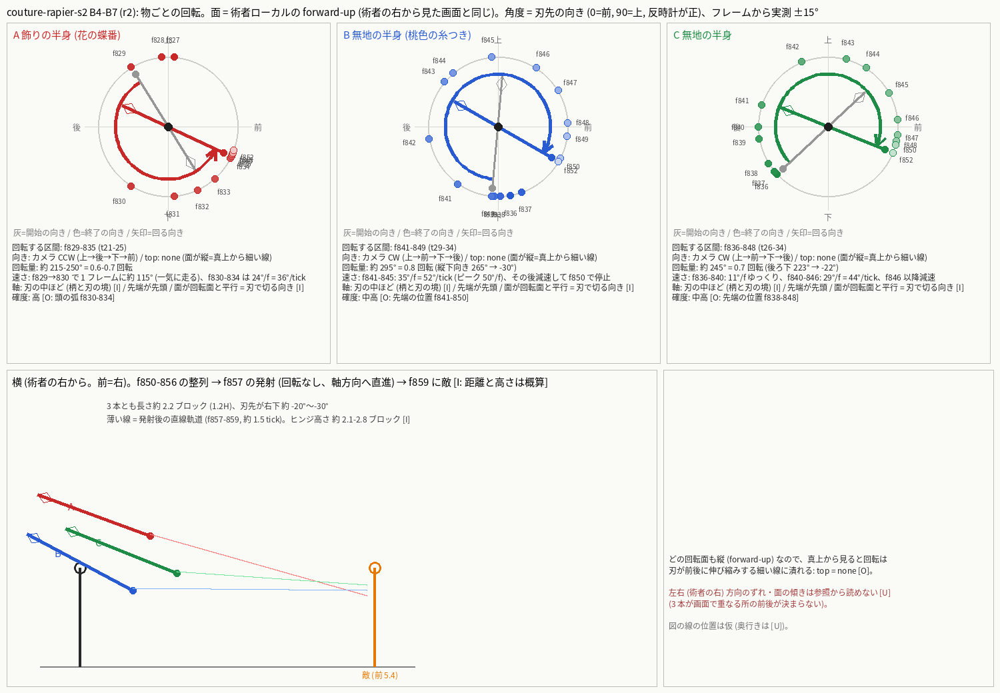
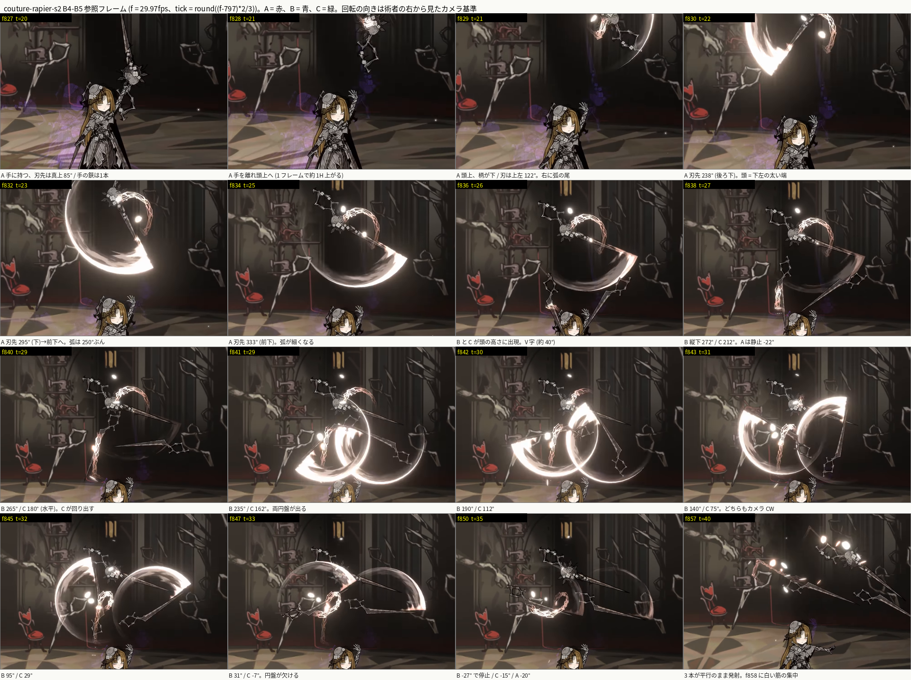

# ビートシート — couture-rapier-s2 (型紙裁ち / Pattern Trim), r2, 創業者ゲート1 (B4-B7 を再観察で書き直し。他は r1 のまま)

```
Case: couture-rapier-s2   Reference: GIe7Fna5LD4 t=25.947..31.498 (f771..f944, 接近 B0 を含む)   Mirrored: no (術者は画面左 = 敵(画面右)へ向かう。skill-compare と同じ向き)
Swings: 3 (すべてエフェクト駆動のコイン。表の swing # = コイン番号。体を振る斬撃は 0)。接触は 3 回、すべてエフェクト駆動: t=9 (f811 リング+細線)、t=41 (f858 半身 3 本の刺さる直前の集中)、t=72 (f905 突進の切り抜け)。f829-849 の A / B / C の回転 (白い三日月の弧) は準備で接触ではない [O]。**物の数 (B4-B7): 半身 3 本 (A 飾り・B 桃色の糸・C 無地)、各自が柄と刃を持つ** [O: f850 f857 f868]
Priority: 突進の鋭さ > 当たり判定 = 見た目のリーチ > VFX > 粒 > 姿勢   (PvP 優先)
Open angle: B0-B3 と B8-B12 は 0° (閉じたまま、r1 のまま未再確認)。B4-B7 は**閉じた鋏そのものが無く**、3 本の単独の半身 (A 飾り / B 桃色の糸 / C 無地) が別々に動く。B5 の f836-838 に B と C が逆さ V 字 (約 40°) で出るが、これは 2 本の別物が近づく形で鋏の開閉ではない [O]
Notes: 下の「Notes」。全セルに [O]/[I]/[U]。
Diagrams: ASCII は下記、PNG は swing-1..3.png / overview.png、**r2: b4b7-rotation.png (物ごとの回転面・向き・角度) / b4b7-strip.png (注釈つき参照フレーム)**
```

観察のみ(スキル YAML も VFX も書かない。既存 intent / keys は参照していない)。根拠は参照動画 GIe7Fna5LD4 の 29.97fps フレーム(グローバル `f`)。ケースの start f797 = **tick 0**。tick = round((f-797) x 2/3)。接近 B0 (f771-796) は case 範囲の前なので**負の tick**。
位置は術者ローカル `(forward, right, up)` ブロック。原点 = 発動時の術者の足元、軸は **発動時の向き**(forward = 敵方向 = 画面右)。ハサミの長さ ≈ 2.2、1H = 1.8 ブロックで換算。敵までの距離 ≈ 3H = 5.4 ブロック [I]。ヨーは + = 術者の左。
camera CW/CCW と top CW/CCW は `docs/contributing/vfx-team/beat-sheet.md` §Vocabulary に従う。座標と移動量は棒人形用の仮説 `[I]`(参照のカメラはパン/ズームするため画面位置は距離にならない)。確かなのは「順序・向き・接触フレーム・開閉」。
**shears 開き角**(列「blade open / closed」): B0-B3 / B8-B12 は 0° (r1 のまま)。B4-B7 は 3 本の単独の半身が別々に動き、閉じた 1 本の鋏は無い (r1 の「閉じた主鋏 + 白い単刃 2」は誤読 = beat-sheet-check.md r2)。

| beat | tick range | swing # | blade-tip start -> end (3D) | rotation direction | rotation angle | edge facing | blade open / closed | reverses previous beat? | body facing and twist | foot positions | hit tick | travel | VFX & particles | sound events |
|---|---|---|---|---|---|---|---|---|---|---|---|---|---|---|
| B0 低い滑走(接近) | -17..-1 (f771-796) [I] | - [O] | 閉じたハサミが体の後ろ低くに流れる。 `(-1.3, 0.3, 0.35)` 保持 [I: 座標。O: f771-796 で刃が後ろ(画面左)低くへ伸び向きが変わらない] | camera: none; top: none [O: 刃は保持] | 0° [O] | 進行軸に沿って後ろへ流れる。edge-on [O: f777] | closed 0°: 細長い 1 本 [O: f777; わずかな開きは区別不能で [I]] | no (最初のビート) [O] | yaw 0 (画面右向き)、低く前傾して滑走。髪とスカートが後ろ(画面左)へ流れる [O: f771-796] | 足は畳まれ床すれすれ、歩幅なし [O]。滑走 [I] | - | 前へ滑走 約 3H = 5.4 ブロック [I: カメラが追尾し距離そのものは [U]] | 薄い紫のもやが背後の床に f777-785 [O]。粒なし [O] | 音楽床のみ。単発の音の山 f778 (t=-13) [O: 時刻]。性格 [U]。vanilla 案 [I]: t=-16 `entity.player.attack.sweep` 小音量 低ピッチ |
| B1 正面立ち | 0 (f797、1 フレーム) [I] | - [O] | f796 の滑走ポーズから f797 で**ポーズが 1 フレームで切り替わる**。立ち姿(3/4 で正面寄り)、閉じたハサミを腰で刃先を前下に持つ。 `(0.9, 0.2, 0.5)` 保持 [I: 座標。O: f797 でハサミが腰から右下へ] | camera: none; top: [U] (切替で経路が見えない) [O: f796→797 に中間フレームなし] | 0° 観測なし。刃は後ろ低く → 前下へ向きが変わる (約 120°) が経路は不明 [O: 切替] | edge-on [I: f797] | closed 0°: 1 本 [O: f797] | no [O: B0 は回転なし。胴の向きだけ変わる] | yaw 0 → -45 (カメラ寄り) 直立 [I: 3/4 見えのため概算] | 両足そろえて直立、接地 [O: f797] | - | none: 滑走が f797 で止まる [O: 背景に対し位置が変わらない] | 紫のもやが消え始める [O: f797]。粒なし [O] | f800 (t=2) に音の山 [O: 時刻]。性格 [U]。vanilla 案 [I]: t=0 `item.armor.equip_chain` 高め |
| B2 逆手の構え (突進姿勢で保持) | 1..8 (f798-809) [I] | - [O] | f797 → f798 で再び**ポーズ切替**: 前傾の突進姿勢で、閉じたハサミを腕ごと**後ろ**(画面左)へ水平に伸ばす。 `(0.9, 0.2, 0.5) -> (-2.2, 0.3, 1.3)` [I: 座標。O: f798-810 で細長い刃が画面左へ胸〜腰の高さで水平に伸び、保持] | camera: none (切替); top: none (保持) [O: 切替で見えない/保持] | 0° [O: f798-809 の刃は不動] | 側面の細い profile がカメラ側 [O: f805] | closed 0°: 細長い 1 本 + 手元の花の蝶番 [O: f805 の拡大] | yes [O: B1 は刃先前下、ここは刃先が真後ろ。1 フレーム切替] | yaw 0 (顔は画面右、髪は左へ流れる)。膝を曲げて前傾、自由な手は前へ [O: f798-810] | 足は踏ん張り接地、前後に開く。位置の詳細は [U] | - | none [O: 背景に対し不動。f809-810 でカメラがパンチイン] | f809-810 に紫のもやが足元に発生(発進のもや)[O]。粒なし [O] | f808-809 (t=8) に音の山 [O: 時刻 26.98s]。性格 [U]。vanilla 案 [I]: t=3 `block.amethyst_block.resonate` 小音量 高ピッチ(溜め) |
| B3 コイン1: リング + 細線 (接触 1) | 9..15 (f811-820) [I] | 1 (エフェクト) [O] | 刃は B2 の位置にほぼ**保持**(f808→811 で腕がやや上がり上体が前へ捻る)[O: f811-820 で刃は概ね不動]。エフェクトの白い三日月(術者の下半身を巻く下側の弧。完全な輪ではない)が 1 フレームで出現し、その場で侵食して消える。 `弧 半径 約 3.3 中心(0,0,0.3)`、太い端が後ろ・細い端が敵側 [I: 座標。O: f811 に完全な形で出現、前方の細い端が f814 までに先に消え、手前下の細線は f818-820 まで残る] 続いて細い白い線が術者の前下から敵の胴を貫いて右上へ斜めに約 3H (t=11-15) [O: f815-820、胴の高さを貫く] | camera: none (水平の輪で奥行き方向); top: CCW 仮 (遠い左前 → 後ろ → 手前右前、約 250-270°)、信頼 低 [U: フレームで掃引方向が決まらない。創業者質問 1] | リング約 250-270° [I] | 刃は edge-on のまま不動 [O] | closed 0° [O] | no [O] | B2 と同じ姿勢を保持 [O: f811-820] | 同じ [O] | **t=9** (f811 リング出現。敵に橙の筋と白い星 f813-814 = t=11 [O]) [O: ±1 フレーム] | 前方 約 5.4+ ブロック先(敵の胴の高さを貫き右上へ抜ける)細線 [I: カメラが引くので概算]。術者は動かない [O] | f811: 白い大きな三日月/リング(後端が太く明るい、#FFFDF9 と薄ピンク #DEC1C9)。敵に橙の筋(#FF9B3A)と白い星の爆ぜ f813-814。白い花びらと火の粉が散る [O]。細い長い白線が術者から敵の上へ f815-819 [O] | 接触の瞬間 (t=9) に孤立した音の山なし。f808-809 (t=8) の山が直前 [O: 時刻]。性格 [U]。vanilla 案 [I]: t=9 `entity.player.attack.sweep` + `entity.sheep.shear` |
| B4 掲げ → 放す → A の回転(1 本目) | 16..25 (f821-835) [I] | - [O] | f821 でポーズ切替、腰で刃先前下 → f825-827 手の中で刃先を真上へ(約 85°)→ f828 に**手を離れ**、1 フレームで頭 1 つ分上の頭上へ(柄が下、刃が上左)→ **f829-835 に A(飾りの半身)が単独で回る**。A は花の蝶番の玉 + 花の輪の菱形の柄 + 長い刃の 1 本の半身で、閉じた鋏ではない [O: f827-835 の拡大]。刃先の向き(前 0° / 上 90°、反時計が正): f829 122° → f830 238° → f831 275° → f832 295° → f833 312° → f834 333° → f835 335° [O: 各フレームで柄の菱形と刃先を見分け、白い三日月の太い端が刃先側] `A 位置 (0.3, 0.4, 3.9) 付近で保持しながら回る(移動はほぼ無い)` [I: 座標。O: 画面上の A の中心は f829-835 でほとんど動かない]。f835 以降 f856 まで A は頭上で刃先 約 -22° (右下) に静止 [O] | camera: CCW (刃先が 上 → 後ろ → 下 → 前)、信頼 高 [O: f829-835 の刃先の位置と弧の太い端]; top: none [O: 回転面は forward-up の縦面 = 真上から見ると細い線] | 約 215-250° ≒ 0.6-0.7 回転 [O: 122° → 335°。f829 → 830 の 1 フレームで約 115° 走る = ピーク約 70°/tick、f830-834 は約 24°/f ≒ 36°/tick]。軸 = 柄と刃の境あたり (蝶番付近) [I] | 刃先が先頭、刃の面が回転面と平行 = 刃が面で切る向き [I] | none: A は 1 本の半身 (開閉なし)、他の半身は f836 まで画面に居ない [O] | yes [O: B3 は刃先後ろ、ここは前下 → 上 → 回転] | yaw -45 → 0 (正面寄りの立ち)。自由な手を上へ開く、f828-830 に見上げる [O: f827-830] | 両足そろえ接地 [O] | - | A は頭上 約 2H で回る。移動なし [O] | A の後ろに白い三日月の尾 (太い明るい頭が刃先、細い尾が後ろ) が f829-835 に 250° ぶん [O: f830 f832 f834]。白い光点 f828。紫のもやは f830 で消える [O] | f824 (t=18) に音の山 [O: 時刻]。性格 [U]。vanilla 案 [I]: t=18 `item.trident.throw` 小音量 |
| B5 B と C の出現 → 回転(2 本目 3 本目)→ 整列 | 26..39 (f836-856) [I] | - [O] | f836 に頭の高さへ無地の半身 2 本 B と C が出現。逆さ V 字 (柄が上、刃先が下で近づく、開き約 40°) [O: f836-838]。B = 桃色のレースのリボン付き、C = 無地 (両方とも飾りは A より少ない)。**出現の前 (f835 まで) 画面に居ない [O]。どこから来たか [U]** (A の分裂 / 術者の手 / 空中の生成の区別が 1 フレーム f835 → 836 の切替で不可)。f836-840 に B は縦下向き (約 265-272°、刃先が真下)、C は後ろ下 223° → 180° (水平) へ。**f841 から両方が回る**: B 235° → f842 190° → f843 140° → f844 130° → f845 95° → f846 57° → f847 31° → f848 3° → f850 -27°。C 162° (f841) → 112° → 75° → 57° → 29° → 6° → -7° → -12° → -15° (f850)。f848-856 に 3 本とも右下 約 -15° 〜 -30° で平行にそろう (A 最上段、B 左下に桃色のレース、C 中央右) [O]。`B 位置 (-0.1, 0.0, 2.9)、C 位置 (0.7, 0.0, 3.2)、A 位置 (0.3, 0.0, 3.9)、刃の長さ 約 2.2` [I: 座標。O: f850 の画面位置の相対と刃の長さ ≒ 1.2H] | camera: CW (B と C の両方。実測は B が 265° → 235° → 140° → 95° → 31° → -27°、C が 223° → 162° → 75° → 29° → -15° と角度が単調に減る = CW)、信頼 中高 [O: 先端の位置 f838-850、レースを目印に]。**B と C は逆回転ではない (両方とも CW)** [O]。A は回らない。top: none (回転面は B / C とも forward-up の縦面 [O: 円盤が正面に丸く見える = 面が画面と平行]。奥行き (術者の右方向) の面の傾きは [U: f841-847 の円盤が画面と平行に近く見える、傾きが 0° か 10-20° かは区別不能]) | B: 約 295° ≒ 0.8 回転 (265° → -30°。f841-845 は約 35°/f ≒ 52°/tick、ピーク 約 50°/f、f846 以降減速して f850 で停止) [O]。C: 約 245° ≒ 0.7 回転 (223° → -22°。f836-840 は約 11°/f ≒ 16°/tick、f840-846 は約 29°/f ≒ 44°/tick、減速して f848-850 で停止) [O]。軸 = 柄と刃の境 (蝶番) 付近 [I: 円盤の中心が刃の中ほどで、柄が円盤の内側に入る] | 刃先が先頭。円盤の外縁が太く明るい白い三日月 = 切る縁は刃先側 [I: 白い三日月の太い端が刃先、細い尾が後ろ] | none: 3 本とも単独の半身。V 字の開き約 40° は B と C が近づく関係で、1 本の鋏の開閉ではない [O: f836-838] | no (A の CCW → B / C は CW だが別物。同じ物体の反転ではない) [O] | yaw 0 (正面寄りの立ち)。自由な腕を f853 から敵へ伸ばす [O: f853-856] | 両足そろえ接地 [O] | - | none: 術者は動かない。3 本は頭上 約 2H で浮かぶ [O] | 白い三日月の円盤 2 つが左右に並ぶ (f841-849、B の円盤が左、C の円盤が右、いずれも CW に掃かれた跡)。レースの桃色の糸が B の近くに垂れる [O]。白い火の粉 [O] | f838 (t=27) と f847 (t=33) に音の山 [O: 時刻]。性格 [U]。vanilla 案 [I]: t=26-39 `block.amethyst_block.chime` を 2 回、低め |
| B6 発射 → コイン2 (接触 2) → 刺さる | 40..51 (f857-874) [I] | 2 (エフェクト) [O] | f857 に 3 本が**平行のまま軸方向 (刃先の向き = 右下) へ直進を始める**。回転はなく、降下でもない [O: f857 で A 約 -37°、B、C も同角で、f850-856 の位置からずれる向きが各刃の軸と平行]。カメラが f857 からズーム。f858 に白い大きな筋が画面右下へ走る (これが接触 t=41)、f859-860 に暗い刃の束が敵に達し (画面右端)、f861-867 に 3 本が約 -30° の 1 つの束に重なって敵に**刺さる**。刺さった束の後ろに桃色の糸の鎖 2 本が左上へ伸びる [O: f861-867]。`3 本 (0.3, 0.0, 2.9-3.9) -> 敵 (5.4, 0.0, 1.4)、軸方向直進、終端 刃先が敵の胸` [I: 座標。O: f857 の向きと f861 の束の位置。直線か緩い弧かは [U] (カメラのズームとパンが重なる)] | camera: none; top: none [O: 回転なし、軸方向の直進] | 0° (回転なし) [O: f857-861 で 3 本の向きが保たれる] | 刃先が先頭 (edge-leading) [O] | none (3 本の単独半身) [O] | no [O] | yaw 0 保持、自由な腕を敵へ伸ばしたまま踏ん張る [O: f858-874] | 接地、動かない [O] | **t=41** (f858 の白い筋の集中。f857 = t=40 は発射の始まり) [O: ±1 フレーム] | 3 本とも発射時に頭上 約 2H から敵まで 約 5.4 ブロックを 約 1.5 tick (f857-860) で到達 [I: カメラがズーム/パンするので距離そのものは概算。O: f857 → f860 の 3 フレーム] | f858 に白い大きな筋が右下へ、f859 以降に白い星の爆発 + 橙の円環、花びら、白い点 [O]。星は f868-874 で細い X の線に縮む [O]。桃色の糸の鎖 2 本 f861-867 [O] | 接触の瞬間の孤立した音なし。f847 (t=33) の山が最後 [O: 時刻]。性格 [U]。vanilla 案 [I]: t=41 `entity.player.attack.sweep` x3 を 1 tick ずらし + `entity.sheep.shear` |
| B7 刺さったまま保持 + 花びら | 52..58 (f875-884) [I] | - [O] | 3 本の半身が敵に平行に刺さったまま (A の花の蝶番が左端に見える、数 3 は f868-880 の重なりから [I])。`3 本 刃先 (5.4, 0.0, 1.3) 付近、柄は敵の左上` [I: 座標。O: f868-880 で斜め -30° の 3 本の線が敵の位置に保たれる、敵の足元に黒いギザギザが f870 頃から出る] | camera: none; top: none [O] | 0° [O] | - | none [O] | no [O] | yaw 0、自由な腕を敵へ伸ばしたまま [O] | 接地 [O] | - | none: 刺さって保持 [O] | 黒いギザギザの破片が敵の足元に f870 頃から、暗い葉の花びらが落ちる、星は薄れて細い X の線 [O: f870-885] | f879 (t=55) に音の山 [O: 時刻]。性格 [U]。vanilla 案 [I]: t=55 `block.amethyst_cluster.break` 小音量 |
| B8 手元へ戻す | 59..63 (f885-892) [I] | - [O] | f886-887 に装飾つきの長い連結ハサミが敵に残り、術者の掲げた手から線でつながる。f888-892 で主ハサミが再び手の上に直立(刃先上、閉)。**このとき敵側の連結ハサミも残り、同時に 2 本見える** [O]。 `(5.4, 0.0, 1.2) -> (0.3, 0.4, 3.9)` [I: 座標。O: f888-892 で主ハサミが手の上。敵側にもう 1 本が残る(武器数の問題、創業者質問 3)] | camera: none (切替/ワープ); top: none [O: 中間なし] | 0° [O] | edge-on [O: f890] | closed 0° [O: f888-892] | yes [O: 敵へ向く → 手へ戻る] | yaw 0 (正面寄り) [I] | 接地 [O] | - | none [O] | 線が術者の手から敵へ f886-887、花びら [O] | f886 (t=59) に音の山 [O: 時刻]。性格 [U]。vanilla 案 [I]: t=59 `item.trident.return` 小音量 |
| B9 低い構え(紫の溜め) | 64..71 (f893-904) [I] | - [O] | 低く構え、画面**左**向き(敵に背)。閉じたハサミは体の後ろ(画面右、敵側)へ黒い刃の扇と格子状の柄の輪が流れ、細い茶色の刃だけが画面左下へ。 `(1.8, 0.2, 0.3)` 後ろ = 敵側 [I: 座標。O: f896 f900 f903 で顔と自由な腕が画面左、黒い刃の扇と格子の輪が右下]。自由な手は画面左(発動方向と逆)へ伸ばす | camera: none (切替); top: none [O] | 約 200° (真上 → 後ろ下) [I: 切替で見えない] | 柄の輪の面がカメラ側 [O: f898] | closed 0° [O] | yes [O: 刃先 上 → 後ろ下] | yaw 180 (画面左向き = 敵に背)、深く前傾、膝を曲げる [O: f896 f900 f903 の顔と腕の向き]。自由な手は画面左へ [O] | 足は広く前後に開き、低く [I: 位置詳細は [U]] | - | none [O] | 半透明の紫の分節シルエットが術者の背後(画面右 = 敵側)に f893-901 に出て、f904 にごく薄く残る [O]。後ろの印と読める [I]。紫のもやが足元に濃く [O] | f901 (t=69) に音の山 [O: 時刻]。性格 [U]。vanilla 案 [I]: t=64 `block.amethyst_block.resonate` 低め(溜め再び)、t=71 無音 |
| B10 コイン3: 突進 + 切り抜け (接触 3) | 72..76 (f905-912) [I] | 3 [O] | 背向き(画面左向き)のまま、閉じたハサミを体の背後に保持して体ごと**平行移動**(体の位置は 0 → 約 9 ブロック。下の座標は体に対する相対)。切り抜けの瞬間は画面いっぱいの白/ピンクの横長の smear(極端な接写)。 `体 (0,0,0) -> (9.0,0,0)、刃先は体に対し (1.8, 0.2, 0.3) 相対で保持` [I: 座標。O: f905-909 は白飽和 2 フレーム + smear 3 フレーム、f909 に橙の筋。f910-912 は敵のアップで長い暗い閉じた鋏が斜めに交差し、白い斜めの切断線 (X)、黄色の円環 #E8DD49、花びら。f913 は既に広角で術者が敵の右、背後に大きな三日月] | camera: none (直線の突き抜け); top: none (直線) [O] | 0°(直線)[O] | edge-leading [I: 刃先は進行方向を向く。敵のアップでは長い暗い鋏が敵を斜めに貫く] | closed 0° [O: f910-912] | yes [I: B9 は画面左向き、f913 以降は画面右向き。振り向きは smear 内で経路と方向 [U]] | yaw 180 → 0 (smear 内で振り向く。経路と方向 [U]) [O: f903 左向き、f913 右向き] | 滑走(足の踏み出しなし)[I] | **t=72** (f905 のフラッシュ開始。敵が打たれて見えるのは f910 = t=75、接触窓 72-75) [O] | 発進〜敵まで 約 5.4 ブロック(接触窓 72-76 のうち 3 tick 以内)[I: smear のためフレームでは測れない] | 画面の白/ピンク smear、橙の筋 (#FF9B3A)、白い切断 X、黄色の円環 (#E8DD49)、花びら、火の粉 [O] | f901 (t=69) の山が直前。t=72 に孤立した音なし [O: 時刻]。性格 [U]。vanilla 案 [I]: t=72 `entity.player.attack.sweep` + `entity.sheep.shear` 低ピッチ、`item.trident.riptide_1` ピッチ 1.5 |
| B11 通過・減速 | 77..87 (f913-928) [I] | 3 [O] | 術者は敵を越えて右側に着地。閉じたハサミを腕ごと**後ろ**(画面左)へ水平に伸ばし、敵を指す(B2 と同じ形)。 `停止位置を原点とした相対 (-2.2, 0.0, 1.3)` 保持 [I: 座標。O: f914-928 で刃が画面左へ水平] | camera: none; top: none [O] | 0° [O] | 側面の細い profile [O: f920] | closed 0° [O] | yes [O: B10 は背向き、ここは画面右向き + 刃を後ろへ水平に伸ばす。振り向きは B10 内] | yaw 0 (顔は画面右、髪は左)、前傾 [O: f914-928] | 踏ん張って減速、位置詳細は [U] | - | 敵を越えて 合計 約 5H = 9 ブロック [I: カメラが引くので概算]。減速して止まる [O] | 大きな淡いピンクの三日月が背後(画面左)に凸が左 "(" 形、速度線 [O: f914-928]。花びら [O] | f917 (t=80) と f920 (t=82) に音の山 [O: 時刻]。性格 [U]。vanilla 案 [I]: t=78 `block.amethyst_cluster.break` 小音量 |
| B12 保持・回復 | 88..97 (f929-943) [I] | - [O] | 刃は B11 のまま。 `(-2.2, 0.0, 1.3)` 保持 [O: f929-943 で変化なし] | camera: none; top: none [O] | 0° [O] | B11 と同じ [O] | closed 0° [O] | no [O] | yaw 0、低く伸ばした姿勢を保持 [O] | 接地、動かない [O] | - | none [O] | 花びらと白い火の粉が薄れる [O: f929-943]。2 発目の接触なし [O] | 音は減衰 [O: 時刻]。vanilla 案 [I]: なし。f944 (t=98) でカメラが広角へハードカットし、術者は待機位置に戻る(スキル外のリセット)[O] |

## r2: B4-B7 の物の台帳と回転 (参照 f815-880 を 1 フレームずつ観察。r1 の B4-B7 は誤り、`beat-sheet-check.md` r2)

注: B0-B3 と B8-B12 は r2 で**再確認していない** (r1 のまま)。B4-B7 の tick 境界は r2 で変えた (B4 = 16..25、B5 = 26..39)。

向きの読み方: カメラは術者の右側 (forward = 画面右、up = 画面上)。**camera CCW = 刃先が 前 → 上 → 後ろ → 下**、**camera CW = 刃先が 上 → 前 → 下 → 後ろ**。刃先の角度は 0° = 前 (画面右)、90° = 上、反時計が正で ±15° の実測。回転面は 3 本とも術者ローカルの **forward-up の縦面** なので、**真上から見ると面が edge-on = 回転は見えない (top: none)** [O]。

| 物 | 数 | 見た目 | 付く先 (いつ) | 現れる / 消える | 回転面 | 向き | 回転量 | 速さ | 軸 | 先頭の縁 | 飛翔 |
|---|---|---|---|---|---|---|---|---|---|---|---|
| A 飾りの半身 | 1 [O] | 花の蝶番の玉 + 花の輪の菱形の柄 + 長い刃 1 本。白い三日月の尾を引く [O] | 術者の手 (〜f827) → 離れて頭上 (f828〜) [O] | f828 に手を離れる、f857 に発射、f861 以降は敵に刺さる (消えない) [O] | forward-up [O] | camera CCW、信頼 高 [O: f829-835] | 約 215-250° ≒ 0.6-0.7 回転 (122° → 335°) [O] | f829 → 830 に 115°/f、f830-834 は 24°/f ≒ 36°/tick [O] | 蝶番付近 [I] | 刃先 (太い明るい端) [I] | 頭上で回りながら静止 → f857 から軸方向へ直進 [O] |
| B 無地の半身 + 桃色の糸 | 1 [O] | 柄と刃の 1 本。桃色のレースのリボンが柄の近くに付く [O] | 頭上 (f836〜)。レースは f830-840 は A の蝶番付近、以降は B [I] | f836 出現 (出所 [U])、f857 発射、f861 以降は敵に刺さる [O] | forward-up [O] | camera CW、信頼 中高 [O: f841-850] | 約 295° ≒ 0.8 回転 (265° → -30°) [O] | f841-845 は 35°/f ≒ 52°/tick、減速して f850 停止 [O] | 柄と刃の境付近 [I] | 刃先 [I] | 頭上 (x -0.1) → 軸方向へ直進 [O] |
| C 無地の半身 | 1 [O] | 柄と刃の 1 本 (飾りなし) [O] | 頭上 (f836〜) [O] | f836 出現 (出所 [U])、f857 発射、f861 以降は敵に刺さる [O] | forward-up [O] | camera CW、信頼 中高 [O: f838-848] | 約 245° ≒ 0.7 回転 (223° → -22°) [O] | f836-840 は約 11°/f、f840-846 は約 29°/f ≒ 44°/tick、減速 [O] | 柄と刃の境付近 [I] | 刃先 [I] | 頭上 (x 0.7) → 軸方向へ直進 [O] |
| 白い三日月の跡 (A) | 1 [O] | 太い明るい頭 (刃先側) + 細い尾、約 250° の弧 [O] | A の刃先 (f829-835) [O] | f829 出現、f835 に消える [O] | A と同じ面 [O] | A と同じ [O] | - | - | - | - | A とともに動く |
| 白い三日月の円盤 (B・C) | 2 [O] | 左 = B の円盤、右 = C の円盤。左右が重なるように並ぶ [O] | それぞれ B / C の刃先 (f841-849) [O] | f841 出現、f849-850 に消える [O] | B / C と同じ [O] | CW [O] | - | - | - | - | B / C とともに動く |

数えきれなかったもの: **B / C の出現前の所在** [U: f835 までは画面に居ない、f836 に頭の高さで現れる。f835 → 836 は 1 フレーム切替で、A の分裂・術者の手・空中の生成を決められない]、**3 本の左右 (術者の右) 方向の位置と面の傾き** [U: 参照が 1 つのカメラで、重なる 3 本の前後が決まらない]、**f878 の刺さった本数** [I: 3 本の重なり]、**桃色のレースの糸と白い光点が独立した物か** [U: 小さく f841 f850 f861 のどれでも他の物と重なる]、**f857-859 の直線か緩い弧か** [U: カメラのズームとパンが同時に動く]。




## Totals and checks

- スイング数: 0 (体の斬撃なし)。接触: t=9 / t=41 / t=72 [O: ±1 フレーム]。YAML 側の `official_coins: 3` と一致 [O]。f829-849 の A / B / C の回転と白い三日月は接触ではなく準備 [O: 敵に反応なし]。
- 反転: 刃の向きは B1 前下 → B2 後ろ → B4 前下/上 → B9 後ろ(敵側)と 1 フレームの**ポーズ切替**で 4 回変わる (経路は見えない) [O]。体は B0-B8 が画面右向き (yaw 0)、**B9 で画面左向き (yaw 180、f893-904)** に変わり、B10 の smear 内で右向きへ振り向く (経路と方向 [U]) [O]。B8 は敵側の鋏が手元へ戻る(ワープ)。S1 の B2-B5 と同じ「背向け突進 → 通過中に振り向く」。
- 開閉 (r2): B0-B3 / B8-B12 は閉 0° (r1 のまま)。B4-B7 は閉じた鋏が無く、3 本の単独の半身 A / B / C が別々に回って飛ぶ [O]。2 枚の半身を 1 つのヒンジで開閉する場面は無い。
- 所要 [I]: -17 → 97 tick。case 範囲 0 → 97 tick (4.85 秒)。接近 B0 は case 範囲の前。
- 接触の間隔: t9 → t41 (32 tick) → t72 (31 tick) [O]。f913 (t=77) 以降は広角で術者は敵の右。
- アニメーションの性質: B0→B1→B2、B3→B4、B8→B9 は**中間フレームのないポーズ切替**(2D 差し替え)で補間ではない [O]。見えるモーションは「滑走」「頭上の浮遊」「突進」だけで、接触は全てエフェクト [O]。

## Notes

- 換算: tick = round((f-797) x 2/3)。f = 29.97fps。f944 以降は戦闘待機に戻るリセットでスキルに含めない。
- 向きの換算: 参照の術者は画面左、敵は画面右で、skill-compare のカメラ(術者の右側。forward = 画面右)と同じ向き。反転なし。S2 の B2 は S1 の B2-B4 と違い**画面右向き**(S1 の B2-B4 は左向きで、S2 の B9-B10 と同型)(顔は右、髪とスカートは左へ流れる)。
- 武器数 (r2 で訂正): B4-B7 の参照は「各自が柄と刃を持つ半身 3 本 (A 飾り / B / C)」で、閉じた主鋏 + 白い単刃 2 ではない。B5-B8 で参照には「頭上の主ハサミ + 白い単刃 2」(r1 の読み。誤り) 「敵に残る長い連結ハサミ」「手に戻った主ハサミ」が同時に出る。再現では常に武器 1 本が見えるルールとどう折り合うかが創業者質問 3。
- 距離の換算: 1H = 1.8 ブロック。敵-術者 ≈ 3H (発動時)、B11 の通過後 ≈ 5H。カメラのパンとズームで誤差が大きい [I]。
- 設計メモ(創業者の既定方針): PvP 優先 = 突進(B10) は 2-3 tick の鋭いバースト、当たり判定 = 見た目のリーチ(細線の長さ・鋏の飛翔距離)、X や三日月は接触の**後**に出るので判定ではなく演出。VFX は術者に追従(リングは術者中心、突進の smear は術者の開始位置から終了位置)。粒は vanilla で十分。音は vanilla のみ(上の案は音のチューニング担当への入力)。コイン1/2 のリングと鋏の飛翔は遠隔なので、命中位置 = 発動時の敵の位置か追尾かが創業者質問 2。
- 不明点 [U] (r2 で B5 の向きは読めた: B4-B7 は上の台帳): B3 の弧の掃引方向、B / C の出現前の所在と 3 本の左右の位置、B10 の振り向きの向き、B10 の smear 中の胴と足、各ポーズ切替の経路、音の性格(時刻のみ。聴いていない。参照の音は音楽床で接触音を分離できない)。

## Diagrams (ASCII, 仮説 [I])

```
TOP (真上。前=右)
 B0 滑走 5.4        B1-B2 停止・構え       B3 リング(径 6.6)   B4-B6 A/B/C が回り → 軸方向へ直進  B10 突進 5.4 → 9
 o--------->        o(胸は右、刃は後ろ)    (o) 周囲に輪         o  ......三本の鋏......>[敵 t41]    o----------->[敵 t72]--------> o
 胸は右(yaw 0)      刃 (-2.2,1.3)          細線 -> 敵 t9        頭上 3.6 から降下                   B9-B10: 胸は左(背向き)で突進、smear 内で右へ振り向く

SIDE (術者の右から。前=右)                   FRONT (敵側から)
 B3: 細線 ----/ 敵の頭上                       B5: 頭上に半身 3 本 (A 飾り / B / C、左右の位置は [U])
 B5-B6: 半身 3 本 (頭上 3.6) 右下 -20° に平行 ---> 軸方向へ直進 -> 敵   B10: 敵から見て X + 黄色の円環
 B10: o ====> [敵] ====> o (胸の高さ)
```

## 棒人形 (仮説 [I])


