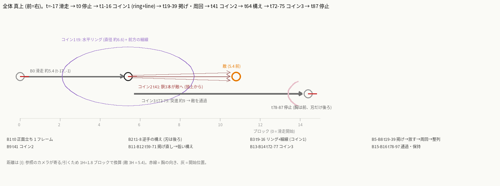
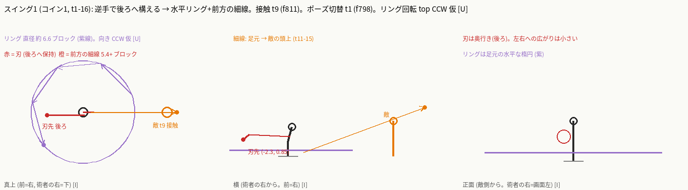
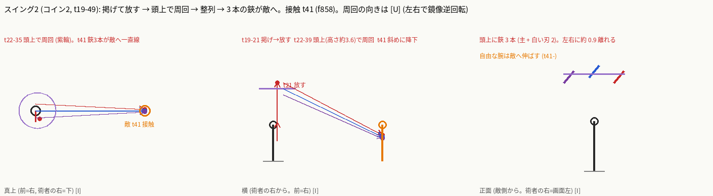
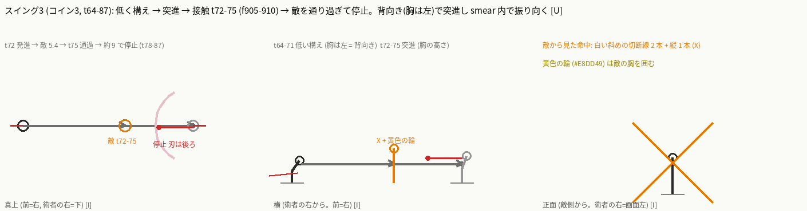

## 施主回答 (2026-10-27) — ゲート 1 通過

ゲート 1 は通過。ビート表は凍結し、実装はゲート 2 (実機確認) に向けて進行中。

- **Q1 = A (コイン3 の振り向き)**: 背向けで構えて突進し、接触の smear 内で時計回りに 180° 振り向く。S1 で施主が選んだ形と同じ。
- **Q2 = B (武器の本数)**: 見える武器モデルは常に 1 本だけ。分離中は手元の鋏を隠し、頭上へ飛ぶ 1 本だけをモデルで出す。白い単刃 2 本と敵に残る連結鋏は粒/スプライトの VFX (モデルではない)。戻りで手元に再表示。
- **Q3 = A (遠隔ヒット)**: コイン1/2 の遠隔ヒットは発動時の敵の位置に固定。線上にいる者に当たる (避けられる)。追尾なし。

# ビートシート — couture-rapier-s2 (型紙裁ち / Pattern Trim), r1, 創業者ゲート1

```
Case: couture-rapier-s2   Reference: GIe7Fna5LD4 t=25.947..31.498 (f771..f944, 接近 B0 を含む)   Mirrored: no (術者は画面左 = 敵(画面右)へ向かう。skill-compare と同じ向き)
Swings: 3 (すべてエフェクト駆動のコイン。表の swing # = コイン番号。体を振る斬撃は 0)。接触は 3 回、すべてエフェクト駆動: t=9 (f811 リング+細線)、t=41 (f858 鋏 3 本の集中)、t=72 (f905 突進の切り抜け)。f830-856 の頭上の大きな三日月は準備で接触ではない
Priority: 突進の鋭さ > 当たり判定 = 見た目のリーチ > VFX > 粒 > 姿勢   (PvP 優先)
Open angle: 全ビートで 0° (閉じたまま)。V 字に開く形は S2 に一度も出ない [O]
Notes: 下の「Notes」。全セルに [O]/[I]/[U]。
Diagrams: ASCII は下記、PNG は swing-1..3.png / overview.png
```

観察のみ(スキル YAML も VFX も書かない。既存 intent / keys は参照していない)。根拠は参照動画 GIe7Fna5LD4 の 29.97fps フレーム(グローバル `f`)。ケースの start f797 = **tick 0**。tick = round((f-797) x 2/3)。接近 B0 (f771-796) は case 範囲の前なので**負の tick**。
位置は術者ローカル `(forward, right, up)` ブロック。原点 = 発動時の術者の足元、軸は **発動時の向き**(forward = 敵方向 = 画面右)。ハサミの長さ ≈ 2.2、1H = 1.8 ブロックで換算。敵までの距離 ≈ 3H = 5.4 ブロック [I]。ヨーは + = 術者の左。
camera CW/CCW と top CW/CCW は `docs/contributing/vfx-team/beat-sheet.md` §Vocabulary に従う。座標と移動量は棒人形用の仮説 `[I]`(参照のカメラはパン/ズームするため画面位置は距離にならない)。確かなのは「順序・向き・接触フレーム・開閉」。
**shears 開き角**(列「blade open / closed」に数値で記録): 全ビート 0°(2 枚の半身 blade-a / blade-b は重ねたまま、ヒンジ +Z で回さない)。S1 の B2-B4 の扇状とは違い、S2 は閉じた 1 本の鋏と、別に飛ぶ 2 本の白い単刃(ヒンジ無し)だけ。

| beat | tick range | swing # | blade-tip start -> end (3D) | rotation direction | rotation angle | edge facing | blade open / closed | reverses previous beat? | body facing and twist | foot positions | hit tick | travel | VFX & particles | sound events |
|---|---|---|---|---|---|---|---|---|---|---|---|---|---|---|
| B0 低い滑走(接近) | -17..-1 (f771-796) [I] | - [O] | 閉じたハサミが体の後ろ低くに流れる。 `(-1.3, 0.3, 0.35)` 保持 [I: 座標。O: f771-796 で刃が後ろ(画面左)低くへ伸び向きが変わらない] | camera: none; top: none [O: 刃は保持] | 0° [O] | 進行軸に沿って後ろへ流れる。edge-on [O: f777] | closed 0°: 細長い 1 本 [O: f777; わずかな開きは区別不能で [I]] | no (最初のビート) [O] | yaw 0 (画面右向き)、低く前傾して滑走。髪とスカートが後ろ(画面左)へ流れる [O: f771-796] | 足は畳まれ床すれすれ、歩幅なし [O]。滑走 [I] | - | 前へ滑走 約 3H = 5.4 ブロック [I: カメラが追尾し距離そのものは [U]] | 薄い紫のもやが背後の床に f777-785 [O]。粒なし [O] | 音楽床のみ。単発の音の山 f778 (t=-13) [O: 時刻]。性格 [U]。vanilla 案 [I]: t=-16 `entity.player.attack.sweep` 小音量 低ピッチ |
| B1 正面立ち | 0 (f797、1 フレーム) [I] | - [O] | f796 の滑走ポーズから f797 で**ポーズが 1 フレームで切り替わる**。立ち姿(3/4 で正面寄り)、閉じたハサミを腰で刃先を前下に持つ。 `(0.9, 0.2, 0.5)` 保持 [I: 座標。O: f797 でハサミが腰から右下へ] | camera: none; top: [U] (切替で経路が見えない) [O: f796→797 に中間フレームなし] | 0° 観測なし。刃は後ろ低く → 前下へ向きが変わる (約 120°) が経路は不明 [O: 切替] | edge-on [I: f797] | closed 0°: 1 本 [O: f797] | no [O: B0 は回転なし。胴の向きだけ変わる] | yaw 0 → -45 (カメラ寄り) 直立 [I: 3/4 見えのため概算] | 両足そろえて直立、接地 [O: f797] | - | none: 滑走が f797 で止まる [O: 背景に対し位置が変わらない] | 紫のもやが消え始める [O: f797]。粒なし [O] | f800 (t=2) に音の山 [O: 時刻]。性格 [U]。vanilla 案 [I]: t=0 `item.armor.equip_chain` 高め |
| B2 逆手の構え (突進姿勢で保持) | 1..8 (f798-809) [I] | - [O] | f797 → f798 で再び**ポーズ切替**: 前傾の突進姿勢で、閉じたハサミを腕ごと**後ろ**(画面左)へ水平に伸ばす。 `(0.9, 0.2, 0.5) -> (-2.2, 0.3, 1.3)` [I: 座標。O: f798-810 で細長い刃が画面左へ胸〜腰の高さで水平に伸び、保持] | camera: none (切替); top: none (保持) [O: 切替で見えない/保持] | 0° [O: f798-809 の刃は不動] | 側面の細い profile がカメラ側 [O: f805] | closed 0°: 細長い 1 本 + 手元の花の蝶番 [O: f805 の拡大] | yes [O: B1 は刃先前下、ここは刃先が真後ろ。1 フレーム切替] | yaw 0 (顔は画面右、髪は左へ流れる)。膝を曲げて前傾、自由な手は前へ [O: f798-810] | 足は踏ん張り接地、前後に開く。位置の詳細は [U] | - | none [O: 背景に対し不動。f809-810 でカメラがパンチイン] | f809-810 に紫のもやが足元に発生(発進のもや)[O]。粒なし [O] | f808-809 (t=8) に音の山 [O: 時刻 26.98s]。性格 [U]。vanilla 案 [I]: t=3 `block.amethyst_block.resonate` 小音量 高ピッチ(溜め) |
| B3 コイン1: リング + 細線 (接触 1) | 9..15 (f811-820) [I] | 1 (エフェクト) [O] | 刃は B2 の位置にほぼ**保持**(f808→811 で腕がやや上がり上体が前へ捻る)[O: f811-820 で刃は概ね不動]。エフェクトの白い三日月(術者の下半身を巻く下側の弧。完全な輪ではない)が 1 フレームで出現し、その場で侵食して消える。 `弧 半径 約 3.3 中心(0,0,0.3)`、太い端が後ろ・細い端が敵側 [I: 座標。O: f811 に完全な形で出現、前方の細い端が f814 までに先に消え、手前下の細線は f818-820 まで残る] 続いて細い白い線が術者の前下から敵の胴を貫いて右上へ斜めに約 3H (t=11-15) [O: f815-820、胴の高さを貫く] | camera: none (水平の輪で奥行き方向); top: CCW 仮 (遠い左前 → 後ろ → 手前右前、約 250-270°)、信頼 低 [U: フレームで掃引方向が決まらない。創業者質問 1] | リング約 250-270° [I] | 刃は edge-on のまま不動 [O] | closed 0° [O] | no [O] | B2 と同じ姿勢を保持 [O: f811-820] | 同じ [O] | **t=9** (f811 リング出現。敵に橙の筋と白い星 f813-814 = t=11 [O]) [O: ±1 フレーム] | 前方 約 5.4+ ブロック先(敵の胴の高さを貫き右上へ抜ける)細線 [I: カメラが引くので概算]。術者は動かない [O] | f811: 白い大きな三日月/リング(後端が太く明るい、#FFFDF9 と薄ピンク #DEC1C9)。敵に橙の筋(#FF9B3A)と白い星の爆ぜ f813-814。白い花びらと火の粉が散る [O]。細い長い白線が術者から敵の上へ f815-819 [O] | 接触の瞬間 (t=9) に孤立した音の山なし。f808-809 (t=8) の山が直前 [O: 時刻]。性格 [U]。vanilla 案 [I]: t=9 `entity.player.attack.sweep` + `entity.sheep.shear` |
| B4 掲げ → 放す | 16..22 (f821-830) [I] | - [O] | f821 で**ポーズが切り替わり**、立ち姿へ戻る。ハサミは腰で刃先前下 → f825-828 で手の中で刃先を真上へ立てて頭上へ掲げる → f829 で手を離れて頭上へ浮かぶ(画面からは消えず、f830 以降は頭上の三日月の中央)。 `(0.9, 0.2, 0.5) -> (0.3, 0.4, 3.9)` [I: 座標。O: f821 腰、f825-828 手の上 約 1.1H、f829 画面上端へ離れる] | camera: CCW (腰の前下 → 上、切替後の持ち上げ)、信頼 中 [I: f822→825→828]; top: none [O] | 約 100° (前下 → 真上) [I] | 刃先は上、edge-on [O: f825-828] | closed 0° [O: f825-829] | yes [O: B3 は刃先後ろ、ここは前下 → 上。f821 切替] | yaw -45 → 0 (正面寄りの立ち)。自由な手の平を上へ開く [O: f829] | 両足そろえ接地 [O] | - | none [O] | 三日月の残滓が f821 前後に薄れる。紫のもやが薄れる [O: f822-829]。粒は少数 [O] | f824 (t=18) に音の山 [O: 時刻]。性格 [U]。vanilla 案 [I]: t=18 `item.trident.throw` 小音量 |
| B5 頭上で周回(離れた鋏 + 白い単刃 2) | 22..39 (f830-856) [I] | - [O] | 離れた飾りつき主ハサミ(閉)と無地の白い単刃 2 本が術者の頭上 約 2H (≈ 3.6 ブロック) に浮かぶ。 `主 (0.2, 0.0, 3.6)、白刃 (0.2, +-0.9, 3.4)` [I: 座標。O: f830-856 で 3 本が頭上に並ぶ。f850-856 で斜めにそろい右下(敵)へ向く] | camera: 鏡像の 2 つの円盤ループ(左右)が逆回転 [O: f842-849]。各ループの向きは [U]。大きな C 1 つ (f831-835) の向きも [U]; top: [U] | ループ 1-2 周 [I] | 刃は edge-on と面が混在 [U] | closed 0°: 主ハサミは閉、白刃は単刃(ヒンジ無し)[I: f842-846 の細部がつぶれて見えないので閉と推定] | no [O] | yaw 0 (敵向きのまま。顔は正面〜右に見える)、自由な腕を f853 から敵へ伸ばす [O: f853-856] | 両足そろえて接地 [O] | - | none [O: 術者は動かない] | 大きな白い三日月ループ: f831-835 に鋏の下に大きな C、f842-849 に左右の円盤 2 つ [O]。白い火の粉 [O]。紫のもや f830 で消える [O] | f838 (t=27) と f847 (t=33) に音の山 [O: 時刻]。性格 [U]。vanilla 案 [I]: t=24-39 `block.amethyst_block.chime` を 2 回、低め |
| B6 整列 → コイン2 (接触 2) | 40..51 (f857-874) [I] | 2 (エフェクト) [O] | 3 本が敵へ平行に並び、上から**降下**。`主 (0.5, 0.0, 3.6) -> (5.4, 0.0, 1.2)`、白刃は平行 +-0.3 ずらす [I: 座標。O: f857 でそろって敵へ向き、f858 に上左からの白い束の筋が集中して敵に星、カメラが f858-863 でパンチ] | camera: none (直線の飛翔); top: none (一直線) [O] | 0°(直線)[O] | edge-leading [I: 刃先を敵へ] | closed 0°(主)/ 単刃 [I] | no (前ビートの整列が続く) [O] | yaw 0 保持、腕は敵へ伸ばしたまま踏ん張る [O: f858-874] | 接地、動かない [O] | **t=41** (f858 の筋の集中と星。f857 = t=40 は整列) [O: ±1 フレーム] | 敵まで 約 5.4 ブロック、頭上 3.6 → 敵の胸 1.2 へ降下 [I] | f858: 白い束の筋 3 本が上左から敵へ集中、星。橙の補助色。星は f870-875 で細い X + 粒に縮む [O] | 接触の瞬間の孤立した音なし。f847 (t=33) の山が最後 [O: 時刻]。性格 [U]。vanilla 案 [I]: t=41 `entity.player.attack.sweep` x3 を 1 tick ずらし + `entity.sheep.shear` |
| B7 花びら・保持 | 52..58 (f875-884) [I] | - [O] | 鋏は敵の位置へ着き、保持。 `敵 (5.4, 0.0, 1.0)` [I: 座標。O: f875-885 で敵の足元に黒いギザギザ、花びらが落ちる] | camera: none; top: none [O] | 0° [O] | - [U: 鋏が敵に隠れる] | closed 0° [I] | no [O] | yaw 0、腕を敵へ伸ばしたまま [O] | 接地 [O] | - | none [O] | 花びらが落ち、敵の足元に黒いギザギザ(影)[O: f875-885]。星は消える [O] | f879 (t=55) に音の山 [O: 時刻]。性格 [U]。vanilla 案 [I]: t=55 `block.amethyst_cluster.break` 小音量 |
| B8 手元へ戻す | 59..63 (f885-892) [I] | - [O] | f886-887 に装飾つきの長い連結ハサミが敵に残り、術者の掲げた手から線でつながる。f888-892 で主ハサミが再び手の上に直立(刃先上、閉)。**このとき敵側の連結ハサミも残り、同時に 2 本見える** [O]。 `(5.4, 0.0, 1.2) -> (0.3, 0.4, 3.9)` [I: 座標。O: f888-892 で主ハサミが手の上。敵側にもう 1 本が残る(武器数の問題、創業者質問 3)] | camera: none (切替/ワープ); top: none [O: 中間なし] | 0° [O] | edge-on [O: f890] | closed 0° [O: f888-892] | yes [O: 敵へ向く → 手へ戻る] | yaw 0 (正面寄り) [I] | 接地 [O] | - | none [O] | 線が術者の手から敵へ f886-887、花びら [O] | f886 (t=59) に音の山 [O: 時刻]。性格 [U]。vanilla 案 [I]: t=59 `item.trident.return` 小音量 |
| B9 低い構え(紫の溜め) | 64..71 (f893-904) [I] | - [O] | 低く構え、画面**左**向き(敵に背)。閉じたハサミは体の後ろ(画面右、敵側)へ黒い刃の扇と格子状の柄の輪が流れ、細い茶色の刃だけが画面左下へ。 `(1.8, 0.2, 0.3)` 後ろ = 敵側 [I: 座標。O: f896 f900 f903 で顔と自由な腕が画面左、黒い刃の扇と格子の輪が右下]。自由な手は画面左(発動方向と逆)へ伸ばす | camera: none (切替); top: none [O] | 約 200° (真上 → 後ろ下) [I: 切替で見えない] | 柄の輪の面がカメラ側 [O: f898] | closed 0° [O] | yes [O: 刃先 上 → 後ろ下] | yaw 180 (画面左向き = 敵に背)、深く前傾、膝を曲げる [O: f896 f900 f903 の顔と腕の向き]。自由な手は画面左へ [O] | 足は広く前後に開き、低く [I: 位置詳細は [U]] | - | none [O] | 半透明の紫の分節シルエットが術者の背後(画面右 = 敵側)に f893-901 に出て、f904 にごく薄く残る [O]。後ろの印と読める [I]。紫のもやが足元に濃く [O] | f901 (t=69) に音の山 [O: 時刻]。性格 [U]。vanilla 案 [I]: t=64 `block.amethyst_block.resonate` 低め(溜め再び)、t=71 無音 |
| B10 コイン3: 突進 + 切り抜け (接触 3) | 72..76 (f905-912) [I] | 3 [O] | 背向き(画面左向き)のまま、閉じたハサミを体の背後に保持して体ごと**平行移動**(体の位置は 0 → 約 9 ブロック。下の座標は体に対する相対)。切り抜けの瞬間は画面いっぱいの白/ピンクの横長の smear(極端な接写)。 `体 (0,0,0) -> (9.0,0,0)、刃先は体に対し (1.8, 0.2, 0.3) 相対で保持` [I: 座標。O: f905-909 は白飽和 2 フレーム + smear 3 フレーム、f909 に橙の筋。f910-912 は敵のアップで長い暗い閉じた鋏が斜めに交差し、白い斜めの切断線 (X)、黄色の円環 #E8DD49、花びら。f913 は既に広角で術者が敵の右、背後に大きな三日月] | camera: none (直線の突き抜け); top: none (直線) [O] | 0°(直線)[O] | edge-leading [I: 刃先は進行方向を向く。敵のアップでは長い暗い鋏が敵を斜めに貫く] | closed 0° [O: f910-912] | yes [I: B9 は画面左向き、f913 以降は画面右向き。振り向きは smear 内で経路と方向 [U]] | yaw 180 → 0 (smear 内で振り向く。経路と方向 [U]) [O: f903 左向き、f913 右向き] | 滑走(足の踏み出しなし)[I] | **t=72** (f905 のフラッシュ開始。敵が打たれて見えるのは f910 = t=75、接触窓 72-75) [O] | 発進〜敵まで 約 5.4 ブロック(接触窓 72-76 のうち 3 tick 以内)[I: smear のためフレームでは測れない] | 画面の白/ピンク smear、橙の筋 (#FF9B3A)、白い切断 X、黄色の円環 (#E8DD49)、花びら、火の粉 [O] | f901 (t=69) の山が直前。t=72 に孤立した音なし [O: 時刻]。性格 [U]。vanilla 案 [I]: t=72 `entity.player.attack.sweep` + `entity.sheep.shear` 低ピッチ、`item.trident.riptide_1` ピッチ 1.5 |
| B11 通過・減速 | 77..87 (f913-928) [I] | 3 [O] | 術者は敵を越えて右側に着地。閉じたハサミを腕ごと**後ろ**(画面左)へ水平に伸ばし、敵を指す(B2 と同じ形)。 `停止位置を原点とした相対 (-2.2, 0.0, 1.3)` 保持 [I: 座標。O: f914-928 で刃が画面左へ水平] | camera: none; top: none [O] | 0° [O] | 側面の細い profile [O: f920] | closed 0° [O] | yes [O: B10 は背向き、ここは画面右向き + 刃を後ろへ水平に伸ばす。振り向きは B10 内] | yaw 0 (顔は画面右、髪は左)、前傾 [O: f914-928] | 踏ん張って減速、位置詳細は [U] | - | 敵を越えて 合計 約 5H = 9 ブロック [I: カメラが引くので概算]。減速して止まる [O] | 大きな淡いピンクの三日月が背後(画面左)に凸が左 "(" 形、速度線 [O: f914-928]。花びら [O] | f917 (t=80) と f920 (t=82) に音の山 [O: 時刻]。性格 [U]。vanilla 案 [I]: t=78 `block.amethyst_cluster.break` 小音量 |
| B12 保持・回復 | 88..97 (f929-943) [I] | - [O] | 刃は B11 のまま。 `(-2.2, 0.0, 1.3)` 保持 [O: f929-943 で変化なし] | camera: none; top: none [O] | 0° [O] | B11 と同じ [O] | closed 0° [O] | no [O] | yaw 0、低く伸ばした姿勢を保持 [O] | 接地、動かない [O] | - | none [O] | 花びらと白い火の粉が薄れる [O: f929-943]。2 発目の接触なし [O] | 音は減衰 [O: 時刻]。vanilla 案 [I]: なし。f944 (t=98) でカメラが広角へハードカットし、術者は待機位置に戻る(スキル外のリセット)[O] |

## Totals and checks

- スイング数: 0 (体の斬撃なし)。接触: t=9 / t=41 / t=72 [O: ±1 フレーム]。YAML 側の `official_coins: 3` と一致 [O]。f830-856 の頭上の大きな三日月ループは接触ではなく準備 [O: 敵に反応なし]。
- 反転: 刃の向きは B1 前下 → B2 後ろ → B4 前下/上 → B9 後ろ(敵側)と 1 フレームの**ポーズ切替**で 4 回変わる (経路は見えない) [O]。体は B0-B8 が画面右向き (yaw 0)、**B9 で画面左向き (yaw 180、f893-904)** に変わり、B10 の smear 内で右向きへ振り向く (経路と方向 [U]) [O]。B8 は敵側の鋏が手元へ戻る(ワープ)。S1 の B2-B5 と同じ「背向け突進 → 通過中に振り向く」。
- 開閉: 全ビート 閉 0° [O]。2 枚の半身を回す場面は無い。
- 所要 [I]: -17 → 97 tick。case 範囲 0 → 97 tick (4.85 秒)。接近 B0 は case 範囲の前。
- 接触の間隔: t9 → t41 (32 tick) → t72 (31 tick) [O]。f913 (t=77) 以降は広角で術者は敵の右。
- アニメーションの性質: B0→B1→B2、B3→B4、B8→B9 は**中間フレームのないポーズ切替**(2D 差し替え)で補間ではない [O]。見えるモーションは「滑走」「頭上の浮遊」「突進」だけで、接触は全てエフェクト [O]。

## Notes

- 換算: tick = round((f-797) x 2/3)。f = 29.97fps。f944 以降は戦闘待機に戻るリセットでスキルに含めない。
- 向きの換算: 参照の術者は画面左、敵は画面右で、skill-compare のカメラ(術者の右側。forward = 画面右)と同じ向き。反転なし。S2 の B2 は S1 の B2-B4 と違い**画面右向き**(S1 の B2-B4 は左向きで、S2 の B9-B10 と同型)(顔は右、髪とスカートは左へ流れる)。
- 武器数: B5-B8 で参照には「頭上の主ハサミ + 白い単刃 2」「敵に残る長い連結ハサミ」「手に戻った主ハサミ」が同時に出る。再現では常に武器 1 本が見えるルールとどう折り合うかが創業者質問 3。
- 距離の換算: 1H = 1.8 ブロック。敵-術者 ≈ 3H (発動時)、B11 の通過後 ≈ 5H。カメラのパンとズームで誤差が大きい [I]。
- 設計メモ(創業者の既定方針): PvP 優先 = 突進(B10) は 2-3 tick の鋭いバースト、当たり判定 = 見た目のリーチ(細線の長さ・鋏の飛翔距離)、X や三日月は接触の**後**に出るので判定ではなく演出。VFX は術者に追従(リングは術者中心、突進の smear は術者の開始位置から終了位置)。粒は vanilla で十分。音は vanilla のみ(上の案は音のチューニング担当への入力)。コイン1/2 のリングと鋏の飛翔は遠隔なので、命中位置 = 発動時の敵の位置か追尾かが創業者質問 2。
- 不明点 [U]: B3 の弧の掃引方向、B5 のループの向きと白刃の形、B10 の振り向きの向き、B10 の smear 中の胴と足、各ポーズ切替の経路、音の性格(時刻のみ。聴いていない。参照の音は音楽床で接触音を分離できない)。

## Diagrams (ASCII, 仮説 [I])

```
TOP (真上。前=右)
 B0 滑走 5.4        B1-B2 停止・構え       B3 リング(径 6.6)   B5-B6 頭上周回 → 敵へ      B10 突進 5.4 → 9
 o--------->        o(胸は右、刃は後ろ)    (o) 周囲に輪         o  ......三本の鋏......>[敵 t41]    o----------->[敵 t72]--------> o
 胸は右(yaw 0)      刃 (-2.2,1.3)          細線 -> 敵 t9        頭上 3.6 から降下                   B9-B10: 胸は左(背向き)で突進、smear 内で右へ振り向く

SIDE (術者の右から。前=右)                   FRONT (敵側から)
 B3: 細線 ----/ 敵の頭上                       B5: 頭上に鋏 3 本 (主 + 白刃 2、左右 +-0.9)
 B5-B6: 鋏 3 本 (頭上 3.6) ---> 斜め降下 -> 敵   B10: 敵から見て X + 黄色の円環
 B10: o ====> [敵] ====> o (胸の高さ)
```

## 棒人形 (仮説 [I]、全体と各コイン)






## チェック結果 (要約)

Check A (逆読み) と Check B (事実確認) を実施し、指摘をすべて反映した (詳細は beat-sheet-check.md)。B9 (f893-904) の向きは私の読みが誤りで Check B が正しいと再観察で確定 (画面左向き = 背向け)。B3 の弧は 1 フレームで完全な形で出現し、掃引として動くフレームが無い。設計の既定として「1 tick で出現して侵食」を推奨 (質問にしない)。

## 創業者への質問 (ゲート 1、最大 3 つ。いずれもフレームだけでは決まらない)

**Q1. コイン3 の突進は「背向け突進 → smear 内で振り向く」を再現しますか?**
確認したフレーム: f896 f900 f903 (画面左向き = 敵に背、紫シルエットは背後)、f905-909 (白/ピンクの smear で胴が見えない)、f913 (画面右向き、敵の右側)。S1 の B2-B5 と同型。smear 内の回転の向きと経路はどのフレームにも写っていない。
A: 背向けで構えて突進 → 接触の瞬間に 180° 振り向く (向きは時計回りで仮置き)。B: 最初から進行方向を向いた突進に簡略化し、構えの背向きだけ見せる (突進は 2-3 tick の直線)。
推奨: B。PvP では突進の鋭さと当たり判定 = 見た目のリーチが優先で、振り向きは smear に隠れて視認できない。S1 の Q1 と同じ答えに揃える。

**Q2. コイン2 の「主ハサミ + 白い単刃 2 + 敵に残る連結ハサミ」は、武器を何本見せますか?**
確認したフレーム: f830 f842 f856 (頭上に主ハサミ + 白い単刃 2)、f862-884 (敵に長い連結ハサミ)、f888-892 (手に戻った主ハサミと敵側の鋏が同時 = 2 本)、f896 (敵側の鋏が残る)。
A: 参照どおり。頭上の 3 本と敵側の 1 本を全部モデルで出し、手元のハサミは分離中は消す。B: 持っている武器は常に 1 本だけ。分離中は手元の武器を隠して頭上へ飛ばす 1 本だけモデル、白い単刃 2 と敵側の連結ハサミは粒/スプライトの VFX (モデルではない)。戻りで手元に再表示。
推奨: B。「同時に見える武器は 1 本」の既定に合い、表示予算も軽い。VFX は術者に追従。

**Q3. コイン1 とコイン2 の遠隔ヒットは「発動時の敵の位置への固定」ですか、追尾ですか?**
確認したフレーム: f811 f817 f820 (敵は動かず細線が敵の胴を貫く)、f857-858 (3 本が静止した敵へ集中)。参照の敵は両方とも静止しているので追尾の有無はフレームに出ない。
A: 発動時の位置に固定、線上に入っていれば当たる (避けられる)。B: 発動後も敵を追尾して必ず当たる。
推奨: A。PvP は避けられる前提で、当たり判定 = 見た目の線の長さ。

## WIP r1 (2026-10-27) — 実機 side 撮影、未完成

ステップ撮影 (全 tick 描画、captureQuality 有効)。**まだ参照に似ていない WIP。** 公開版は公式の判定ではない。

出来ている点: t9-11 の低く横に広い白い三日月 (硬い縁)、t41-44 の前方だけに広がる羽の束 (28 本)、頭上で飛ぶ鋏 1 本 + 小さい輪 1 つ、t58-62 の太い連結線 + 火花、手元の鋏は飛行中だけ非表示 (hidden model)。

既知の差分 (open diffs):
- particles/texture: t42 の羽束がぼやけた白い塊 (参照は先端が鋭く、羽の間に暗い隙間)。羽スプライトをもっと細く鋭くする。
- particles: t9 の三日月が脚まわりのドームに見える (参照は腰の高さで敵側へ開く掃き)。
- particles: t72 の筋は白一色 (参照の白+ピンクの smear・暗いブラシ模様に届かない)。
- animation (別担当): 体のポーズ (投げ・突進・受け) は main に反映済み。振り向き 180° は top 視点で未確認。
- 未確認: top 視点、音、粒数の記録、reviewer の ○×。
