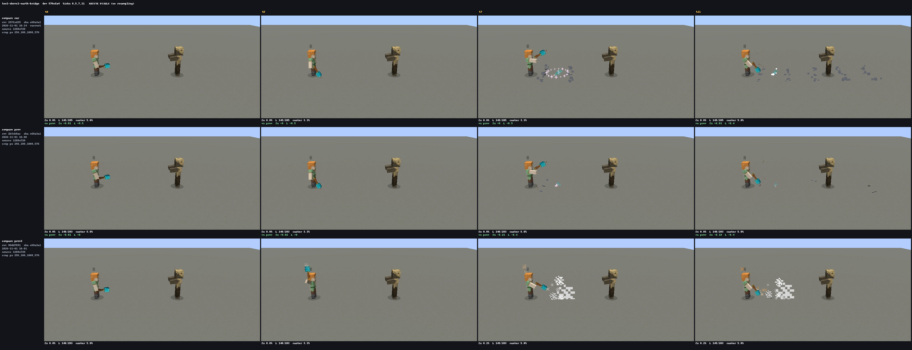

# shovel-earth-bridge — presentation pass

Baseline: unmodified content at `e68a3a18`. Cases contain no reference video.

Underhand building scoop. Clay dust pushes outward along the inherited bridge length and width 0.15 blocks above the deck surface; packed-mud/rooted-dirt placement sounds replace breaking.

Stone | iron | diamond: material debris | metallic sparks/ring | cyan flash/end-rod/chime.
The shared stone document owns the sequence; tier documents only override values.

Mechanics: the original break/place row, state duration, cooldown and tier dimensions are unchanged. `block_damage: 100` matches ADR-0297 (base damage before held-tool tier multipliers), so no contradiction was found.

Review evidence is under `/tmp/claude-1000/tool-skills/round-N/`; all 54 real-client captures are complete and have zero missing ticks. Sound: not listened.

Validation: content-lint uses the production loader. New integration coverage: `ToolSkillPresentationScenarioTest.tool families propagate material effects and tier light through the real cast path` (manager runs it; no tests executed in this worktree).

Round 2 preserves the first round’s main bursts, fills the quarter/three-quarter gaps, and adds a delayed deepslate settling ring to shatter. Bridge emissions are above the deck surface so the floor cannot hide them.

Round 1 review: rejected. Its deck emissions at feet -0.15 were hidden by the flat capture floor. Round 2 moves them to feet +0.15 and fills the travelling-wave gaps; mechanical bridge cells remain at feet -1.

## Validation and integration

Content-lint: PASS (39 runtime categories, 0 failures; 969 pack files, 0 unresolved references). Game-sim and Konsist test sources compile. Test tasks, e2e and check were not run, per worker instructions. The manager must run `ToolSkillPresentationScenarioTest` and Konsist, and regenerate the 18 intentional `skill-oracle/<skill>/skill.txt` presentation goldens. Sound is not listened and has no approval.

## Documentation drift found

- `docs/vision/VISION.md` still says CEL is unimplemented; the current engine and shipped skills use CEL, including the existing shatter aim-point expression. Followed the implementation.
- `docs/contributing/vfx-team/sound.md` still shows the old `type: play_sound` / `delay_ticks` dialect; current v3 skills use `op: sound` / `at`. Followed the implementation.
- `docs/contributing/vfx-team/skill-preview.md` and `make skill-trace` depend on `SkillTraceExportScenarioTest`, which is absent from this checkout. Real-client captures were used, so no synthetic preview was substituted.

Area-spec update belongs to ops-harness: append the 18 tool skill presentation sequences and the six review cases to the 現状 section of `docs/vision/areas/skills-vfx.md`. No engine, model, sound asset, language or harness source files were changed.

## Final comparison

Rows: round 2 / round 1 / baseline. Columns: wind-up / impact / propagation / settle. These are the standard skill-compare API pixels, without hand-made crops.

Before: `/tmp/claude-1000/tool-skills/round-0/tool-shovel-earth-bridge.png`

After: `/tmp/claude-1000/tool-skills/round-2/tool-shovel-earth-bridge.png`

Case: `tool-shovel-earth-bridge`; skill: `shovel-earth-bridge-diamond`. All three tiers were captured in every round.

Review: final material footprint and tool motion remain legible; round 2 retains the round-1 primary effects and adds intermediate debris. The bridge floor occlusion found in round 1 is fixed. Human sound approval and manager integration checks remain pending.
